<div align="center"><a name="readme-top"></a>

<a href="https://zjywlive.github.io/unscheduled-burn-space-apps-2026/demo/">
  
</a>

<h3>Pick a landing site <i>and a landing date</i> at the lunar south pole, plan the rover drive, then fly it.</h3>

<p>
  <a href="https://zjywlive.github.io/unscheduled-burn-space-apps-2026/demo/"><b>🚀 Live demo</b></a> ·
  <a href="https://zjywlive.github.io/unscheduled-burn-space-apps-2026/demo/overview.html"><b>👋 Overview</b></a> ·
  <a href="https://www.youtube.com/watch?v=FLRYPm9GKu8"><b>🎬 30 s video</b></a> ·
  <a href="docs/GUIDE.md"><b>📖 User guide</b></a> ·
  <a href="docs/NASA-MISSION-PLANNING.md"><b>🛰️ Mission-planning guide</b></a> ·
  <a href="mcp/README.md"><b>🤖 MCP server</b></a>
</p>

<p>
  <a href="https://www.spaceappschallenge.org/2026/challenges/lunar-landing-site-navigator/"></a>
  <a href="https://www.spaceappschallenge.org/2026/challenges/lunar-landing-site-navigator/"></a>
  
  <br>
  <a href="https://zjywlive.github.io/unscheduled-burn-space-apps-2026/demo/"></a>
  
  
  
  
  <a href="LICENSE"></a>
</p>

<a href="https://zjywlive.github.io/unscheduled-burn-space-apps-2026/demo/globe.html">
  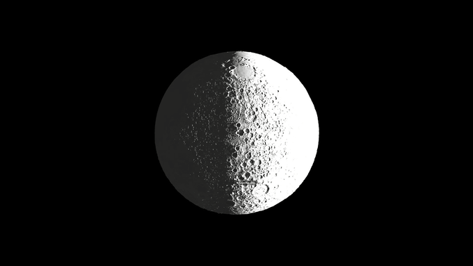
</a>
<sub>From the whole Moon down to 20 m at the south pole: real LRO LOLA elevation, rendered live in your browser. No video, a screen capture of the app.</sub>

</div>

<br>

<details>
<summary><kbd>📑 Table of contents</kbd></summary>

- [🌗 Why the date matters as much as the place](#-why-the-date-matters-as-much-as-the-place)
- [🧭 Plan before launch, then fly](#-plan-before-launch-then-fly)
- [✨ Features](#-features)
- [⚡ Quick start](#-quick-start)
- [🗂️ Repository layout](#️-repository-layout)
- [👩‍🚀 Team](#-team)
- [🛰️ NASA data and other resources](#️-nasa-data-and-other-resources)
- [🤖 Use of AI tools](#-use-of-ai-tools)
- [📄 License](#-license)

</details>


## 🌗 Why the date matters as much as the place

<table>
<tr>
<td width="48%" valign="top">

At the lunar south pole the Sun never climbs high. It **circles the horizon**, and a ridge 10 km away decides
whether a lander's panels get light, while Earth (and so the radio link) bobs in and out of view.

So the same spot can be a great landing site one week and a dark, silent one the next.
**Lunar Site Navigator** answers both questions together: *where* to land, and *when*.

- ☀️ Sun and 🌍 Earth above the **real terrain skyline**, hour by hour
- ⏱️ What happens if the landing **slips** by days or weeks
- 🛰️ Better cells nearby, permanently shadowed regions, slope, possible ice
- 🚙 A rover route that can **actually be driven**: slope, battery, comms and a way out

</td>
<td width="52%" valign="top">

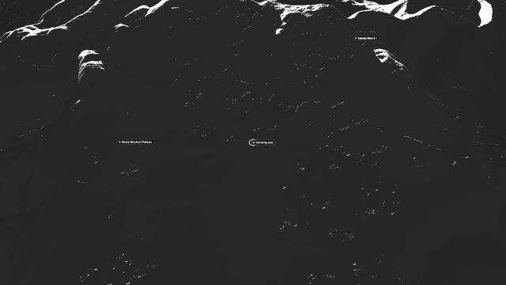
<sub>One lunar day of real light over a south-pole site: the Sun's real direction at landing, turned once about the Moon's spin axis.</sub>

</td>
</tr>
</table>


<div align="center">
  <h3>🎬 Watch the 30-second demo</h3>
  <a href="https://www.youtube.com/watch?v=FLRYPm9GKu8">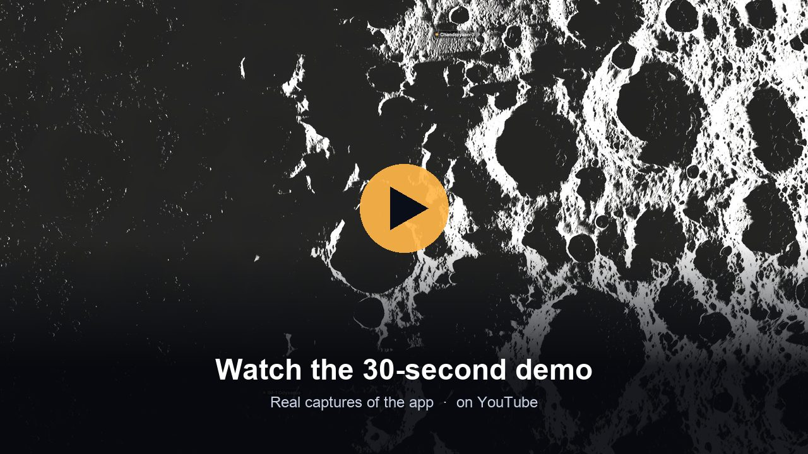</a><br>
  <sub>▶ Click to play on YouTube</sub>
</div>

<div align="right"><a href="#readme-top"><sub>↑ back to top</sub></a></div>

## 🧭 Plan before launch, then fly

Every page carries the same stage bar. Everything is decided on the Map, checked and frozen in Finalise, then
flown exactly as frozen in Execute.

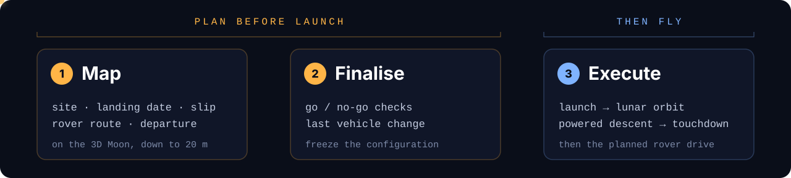

<table>
<tr>
<td width="33%" align="center"><a href="https://zjywlive.github.io/unscheduled-burn-space-apps-2026/demo/">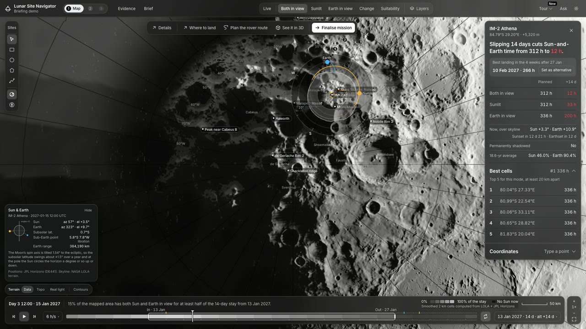</a><br><b>1 · Map</b><br><sub>Site, landing time and slip, rover route, departure. On the 3D Moon.</sub></td>
<td width="33%" align="center"><a href="https://zjywlive.github.io/unscheduled-burn-space-apps-2026/demo/finalise.html">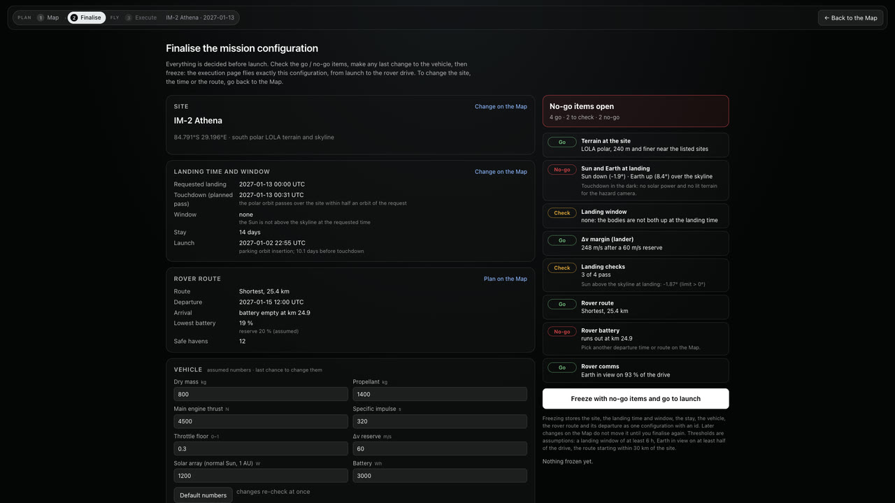</a><br><b>2 · Finalise</b><br><sub>Go / no-go checks, the last vehicle change, then freeze.</sub></td>
<td width="33%" align="center"><a href="https://zjywlive.github.io/unscheduled-burn-space-apps-2026/demo/lander.html">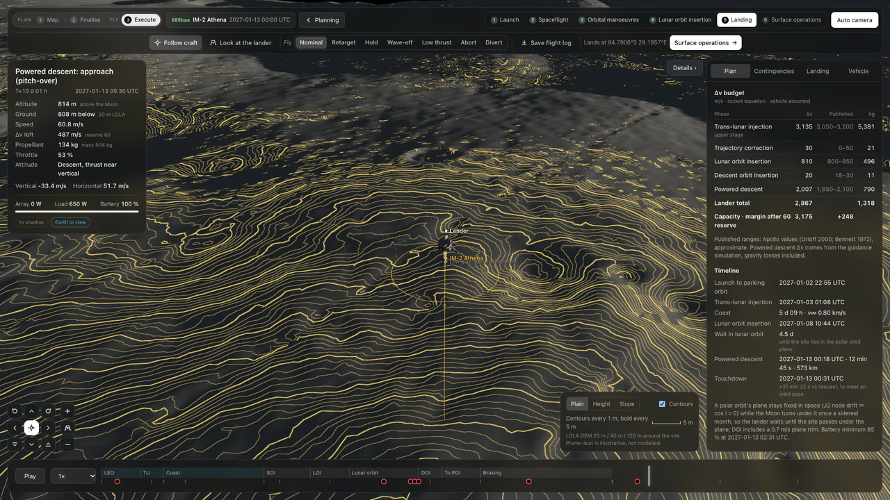</a><br><b>3 · Execute</b><br><sub>Launch, lunar orbit, powered descent, touchdown, rover drive.</sub></td>
</tr>
</table>

<div align="right"><a href="#readme-top"><sub>↑ back to top</sub></a></div>

## ✨ Features

<table>
<tr>
<td width="55%"></td>
<td width="45%" valign="top">

### 🎯 Landing sites

Pick a site and a landing date and see where the Sun and Earth sit above the **real terrain skyline**, how many
hours of the stay have both in view, how that changes if the landing slips, and which nearby cells do better.

Permanently shadowed regions, NASA's 18.6-year illumination averages, slope, possible ice and lander energy are
on the same map.

</td>
</tr>
<tr>
<td width="45%" valign="top">

### 🔍 Where to land

Draw a region anywhere on the Moon and **screen it**: a two-stage search scores landing ellipses, checks slip
robustness with Monte Carlo touchdowns, and shows the nearest misses and why they missed.

</td>
<td width="55%">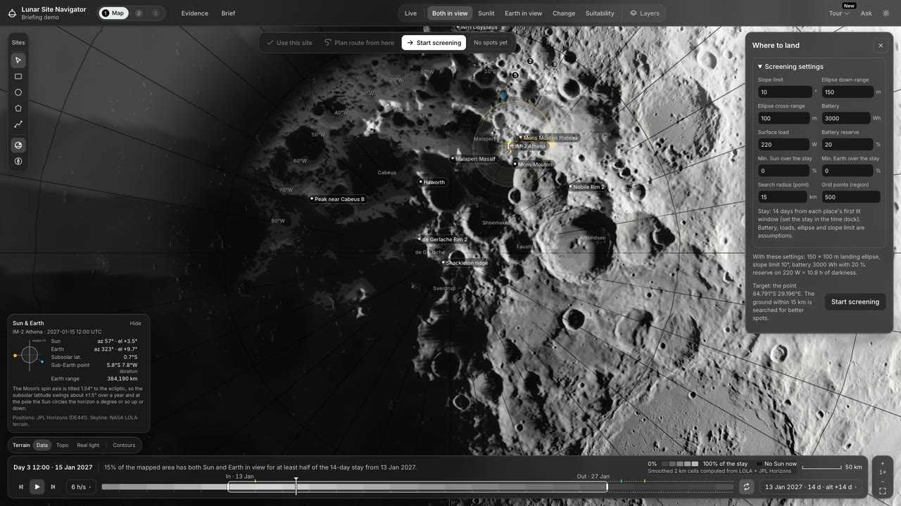</td>
</tr>
<tr>
<td width="55%">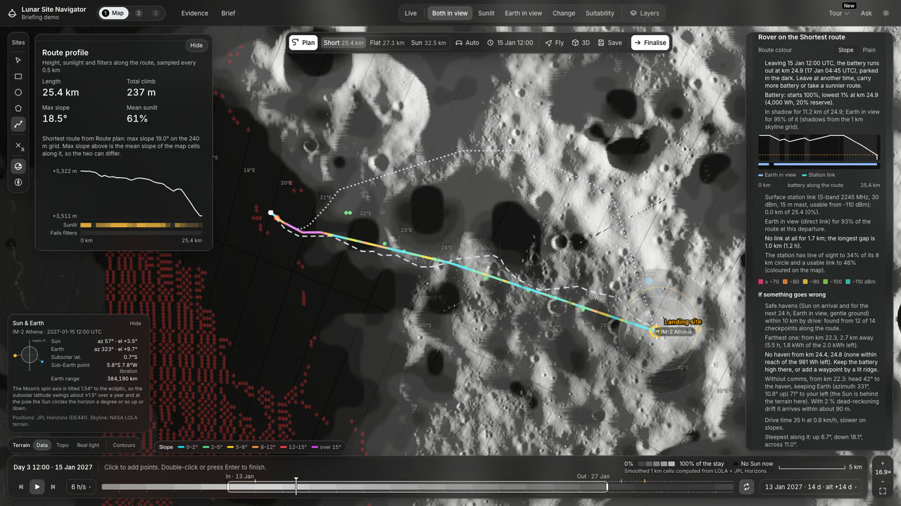</td>
<td width="45%" valign="top">

### 🚙 Rover routes

Three candidates (shortest, flattest, sunniest), then for the chosen one:

- **Mobility:** climb, descent and cross-slope limits, one-way stretches, traps
- **Energy:** the drive simulated in time with panel power only where the Sun clears the skyline
- **Comms:** surface-station coverage with knife-edge diffraction, Earth in view, link gaps
- **Contingency:** the nearest safe haven from every 2 km, and a comms-denied heading

</td>
</tr>
<tr>
<td width="45%" valign="top">

### 🌐 Fly along in 3D

One globe from the whole Moon down to 20 m at the pole. A six-wheeled rover drives the planned route and tilts
with the ground, with contours, the elevation profile, no-go ground as red volumes and a follow camera.
A B-RRT* self-driving planner shows its search trees.

</td>
<td width="55%">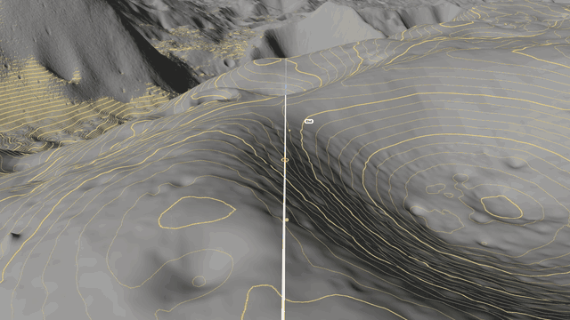</td>
</tr>
<tr>
<td width="55%">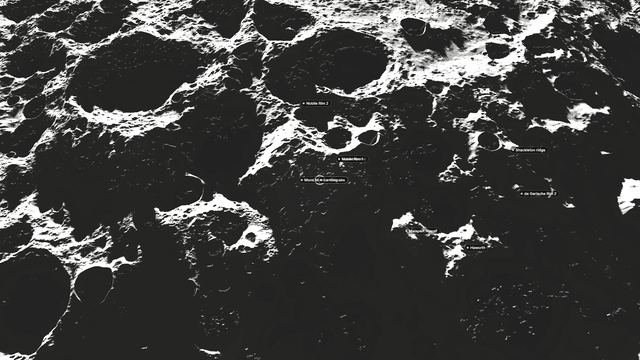</td>
<td width="45%" valign="top">

### 🛬 Execute the landing

The frozen plan flown by a generic robotic lander: Earth parking orbit, lunar orbit insertion, powered descent
onto 5 to 20 m terrain. Δv and propellant budget against Apollo figures, J2/C22 and third-body dynamics, and
contingency branches (abort to orbit, divert, wave-off, hold). An *Earth link* card shows range, delay and
link margin as it flies.

</td>
</tr>
<tr>
<td width="45%" valign="top">

### 🧾 Evidence for every number

Each figure says where it comes from, which NASA dataset it was computed from, and what was cross-checked
(for example our Sun and Earth angles against JPL Horizons). Vehicle, rover and radio figures are labelled as
assumptions the user can change.

</td>
<td width="55%">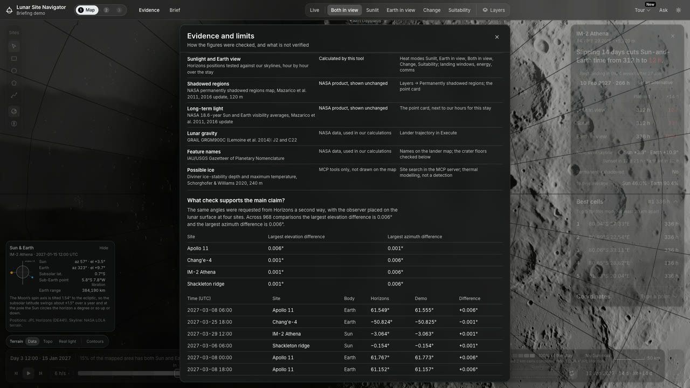</td>
</tr>
</table>

<details>
<summary><b>🤖 MCP server and the "Ask" assistant</b></summary>
<br>

The compute tools are also an **MCP server** ([`mcp/README.md`](mcp/README.md)): site search, Sun and Earth
visibility, slip checks, landing windows, energy, relay coverage and a mission bridge back to the page, so an
AI assistant can plan with the same code. The navigator's *Ask* panel answers questions with the page's own
tools (an offline scripted demo by default; optionally a model with your own API key).

</details>

<details>
<summary><b>📋 Full feature list (every page)</b></summary>
<br>

**Landing sites (navigator, `demo/index.html`).** Pick a site and a landing date and see where the Sun and
Earth sit above the real terrain skyline, how many hours of the stay have both in view, how that changes if the
landing slips, and which nearby cells do better. Permanently shadowed regions, NASA's 18.6-year illumination
averages, slope and energy for a lander's panels are on the same map.

**Rover routes (navigator, route card).** Draw or type a route and get three candidates (shortest, flattest,
sunniest), then for the chosen one:
- *Mobility:* every move is checked against climb, descent and cross-slope limits; one-way stretches (too
  steep to drive back up), whether the rover can get back to the start at all, and trap ground it could drive
  into but not out of.
- *Energy:* the drive is simulated in time from a departure, with panel power only where the Sun clears the
  local skyline; battery along the route, parking to recharge, where the battery would run out, and a search for
  departure times that work.
- *Communications:* a surface station's coverage over the terrain (free-space loss plus knife-edge
  diffraction, following the JPL surface-station concept), Earth in view along the drive, and the gaps with no
  link at all.
- *Contingency:* the nearest safe haven (sunlit for a day, Earth in view, reachable with the battery left) from
  every 2 km of the route, and a comms-denied heading using the Sun and Earth.

**Plan before launch, then fly.** Every page carries the same stage bar: *Plan* 1 Map → 2 Finalise, then *Fly*
3 Execute. Everything is decided on the Map, which is the 3D Moon: one globe from the whole Moon down to 20 m at the south pole,
carrying the south-pole analysis (heat modes, terrain styles, contours, sites, regions, routes) on its surface,
with the drawing tools working on it ([docs/MAP-3D.md](docs/MAP-3D.md)). There the user picks the site anywhere,
the landing time and its slip, the rover route and its departure; Where to land scores landing spots near any point. Finalise (`demo/finalise.html`) checks go / no-go, takes the last change to the assumed
vehicle and freezes the configuration; Execute (`demo/lander.html`) flies exactly that configuration: launch,
spaceflight, orbital manoeuvres, lunar orbit insertion, landing, and surface operations (the planned rover drive).

**3D (`demo/globe.html`).** A globe of the whole Moon from LOLA elevation at several levels of detail, down to
20 m at the south pole and 5–20 m around the landing sites, with contour lines on request and on-screen camera
controls (pan, zoom, turn, tilt, north up; keys too). "Fly along in 3D" puts the planned route on it and plays the
simulated rover along it: a six-wheeled model that tilts with the ground (pitch, roll and yaw shown on the left,
its coordinate frames on request), a minimap with shaded terrain and contours, the elevation profile along the
bottom (click it to move the rover), the route coloured by drive state or by slope, no-go ground as red volumes,
leg distances and times, the self-driving planner's search, and a follow camera. The rover's motion can be
recorded and saved with the route. Waypoints placed on the globe go back to the navigator to be planned, and a
"Mapped" layer shows which terrain the app already has at each resolution, the ground saved drives covered, and
the areas the team marks to map next.

**Saving.** A mission (route, settings, drive simulation, terrain profile, recorded motion) is kept in the
browser and downloads as JSON, GeoJSON or CSV; saved missions load back into the navigator.

**Self-driving planner.** Besides the A* candidates, a B-RRT* planner grows two random trees per leg under the
same direction-dependent slope limits, moves a waypoint it cannot reach, and aborts after a few tries; its trees,
candidate paths and chosen trajectory show on the map and in 3D.

**Overview (`demo/overview.html`).** One page for a first-time visitor: why a polar landing site is a date as much as a
place, the three-step process, a table from each NASA dataset to the planning question it answers, three interactive
models of the algorithms on toy terrain (the skyline test, the two-stage Where to land screen, the A* route search under
slope limits), and the contingency rules (the Execute page's own decision table, and the rover's safe havens).

**Execution (`demo/lander.html`).** The frozen configuration flown by a generic robotic lander from Earth parking
orbit through lunar orbit to a powered descent at the site: Δv and propellant budget, J2/C22 and third-body
dynamics, power and attitude, landing checks against the terrain, contingency branches (abort to orbit, divert,
wave-off, hold), then the rover drive on the 3D globe. The Earth scene marks an illustrative launch site and ascent and
animates the upper-stage separation; a *What's happening* card explains each phase in plain words, and an *Earth link*
card shows line of sight, range, signal delay, path loss and link margin as the flight goes (the radio is an assumption,
labelled so). A link with `?site=…&t=…` flies a labelled rehearsal
instead. **Where to land (`demo/planner.html`)**, the Map's region level, scores a landing ellipse and finds better
spots near any point on the Moon. See `docs/LANDER.md`.

All vehicle, rover and radio figures are assumptions the user can change; the cards label them so. The decision
variables and their sources are listed in `docs/VARIABLES.md`, the build in `docs/PHASES.md`. How to use every page
is in the [user guide](docs/GUIDE.md) ([glossary](docs/guide/glossary.md), [FAQ](docs/guide/faq.md)), and how NASA
plans a landing in [docs/NASA-MISSION-PLANNING.md](docs/NASA-MISSION-PLANNING.md).

</details>

<div align="right"><a href="#readme-top"><sub>↑ back to top</sub></a></div>


## ⚡ Quick start

> **No install.** Open the [live demo](https://zjywlive.github.io/unscheduled-burn-space-apps-2026/demo/) (or the [overview](https://zjywlive.github.io/unscheduled-burn-space-apps-2026/demo/overview.html) first), or run it locally with
> Node 22+ and Python 3 (only for a static web server). The pages also open straight from the files, offline.

```sh
git clone https://github.com/zjywlive/unscheduled-burn-space-apps-2026.git
cd unscheduled-burn-space-apps-2026
python3 -m http.server 8731 --directory demo
```

| Open | What you get |
|---|---|
| http://localhost:8731/overview.html | 👋 The overview: why, how, and small interactive models of the algorithms |
| http://localhost:8731/ | 🗺️ Step 1, the Map (south-pole navigator on the 3D Moon) |
| http://localhost:8731/finalise.html | ✅ Step 2, Finalise: go / no-go and freeze |
| http://localhost:8731/lander.html | 🛬 Step 3, Execute: fly the frozen plan |
| http://localhost:8731/globe.html | 🌐 The 3D global terrain |

<details>
<summary><b>🔧 Rebuild, test, add the 474 m global tiles</b></summary>
<br>

Rebuild the pages after changing `demo/src/`:

```sh
node tools/build.mjs          # demo/index.html
node tools/build-globe.mjs    # demo/globe.html
node tools/build-lander.mjs   # demo/lander.html, planner.html, finalise.html
```

Run the tests:

```sh
node --test 'tests/*.test.mjs'
```

The 474 m global terrain tiles are not in the repository (about 425 MB). To add them (the globe falls back to
1.9 km without them):

```sh
node tools/fetch-global.mjs   # about 595 MB from NASA PDS into data-raw/
node tools/build-global.mjs --g2
```

</details>

## 🗂️ Repository layout

| Path | What it is |
|---|---|
| `demo/` | The web app: `index.html` (built single file), `src/` (ES modules), `data/` (terrain and ephemeris packs), `vendor/` |
| `tools/` | Zero-dependency Node build and data scripts (`node tools/build.mjs` rebuilds `demo/index.html`) |
| `tests/` | Node test suite: `node --test 'tests/*.test.mjs'` |
| `mcp/` | MCP server exposing the compute tools, site search, slip checks, the mission bridge, prompts and resources (`mcp/README.md`) |
| `docs/` | [User guide](docs/GUIDE.md), [how NASA plans a landing](docs/NASA-MISSION-PLANNING.md), design notes; `docs/readme/` holds this page's images |

<div align="right"><a href="#readme-top"><sub>↑ back to top</sub></a></div>

## 👩‍🚀 Team

<div align="center">
<sub><b>Team Unscheduled Burn</b> · Bristol (UK) Local Event · 14–15 November 2026</sub>
<br><br>

<table>
<tr>
<td align="center" width="20%"><a href="https://github.com/zjywlive"></a><br><b>Yinan Zhang</b><br><sub>Developer</sub><br><a href="https://github.com/zjywlive"><sub>@zjywlive</sub></a></td>
<td align="center" width="20%"><a href="https://github.com/PaperPlaneLSY"></a><br><b>Shiyu Luo</b><br><sub>Tester</sub><br><a href="https://github.com/PaperPlaneLSY"><sub>@PaperPlaneLSY</sub></a></td>
<td align="center" width="20%"><a href="https://github.com/Pro-Machine"></a><br><b>Kaan Karadağ</b><br><sub>Researcher</sub><br><a href="https://github.com/Pro-Machine"><sub>@Pro-Machine</sub></a></td>
<td align="center" width="20%"><a href="https://github.com/saintbridgethefirst"></a><br><b>Rushi Vibhandik</b><br><sub>Reviewer</sub><br><a href="https://github.com/saintbridgethefirst"><sub>@saintbridgethefirst</sub></a></td>
<td align="center" width="20%"><a href="https://github.com/1984tkr"></a><br><b>Wantong Wu</b><br><sub>Tester</sub><br><a href="https://github.com/1984tkr"><sub>@1984tkr</sub></a></td>
</tr>
</table>
</div>

<div align="right"><a href="#readme-top"><sub>↑ back to top</sub></a></div>


## 🛰️ NASA data and other resources

Every dataset, library, tool, image and piece of text used in the project is listed here,
as the submission rules require.

<p>
  
  
  
  
  
  
</p>

| Resource | Source | How we used it |
|---|---|---|
| LRO LOLA GDR global DEMs `LDEM_4`, `LDEM_16`, `LDEM_64` (4 / 16 / 64 px per degree) | NASA PDS Geosciences Node, https://pds-geosciences.wustl.edu/lro/lro-l-lola-3-rdr-v1/lrolol_1xxx/data/lola_gdr/cylindrical/img/ | Global terrain model: whole-Moon levels of detail at 7.6 km, 1.9 km and 474 m (`tools/build-global.mjs`) |
| LRO LOLA GDR polar DEMs `LDEM_75S_240M`, `_75S_120M`, `_80S_40M`, `_875S_20M`, `LDEM_75N_240M` | NASA PDS Geosciences Node, https://pds-geosciences.wustl.edu/lro/lro-l-lola-3-rdr-v1/lrolol_1xxx/data/lola_gdr/polar/img/ | South-pole terrain down to 20 m; north-pole cap at 480 m |
| LRO LOLA GDR polar DEMs `LDEM_875S_5M`, `LDEM_85S_10M`, `LDEM_80S_20M` (byte ranges only) | same | 10 × 10 km patches at 5 / 10 / 20 m around each landing site (`tools/fetch-hires.mjs`), for the descent view and the globe |
| Mazarico et al. PSR and average-visibility rasters (`LPSR_75S_120M_201608`, `AVGVISIB_75S_120M_201608`, `_EARTH`) | http://imbrium.mit.edu/EXTRAS/ILLUMINATION/IMG | Permanently shadowed regions and long-term Sun/Earth visibility |
| Diviner south-pole ice-table depth and maximum-temperature grids (`polar_south_80_zit-1.grd`, `polar_south_80_Tmax.grd`); Schorghofer & Williams (2020), PSJ 1:54, DOI 10.3847/PSJ/abb6ff | UCLA Diviner, https://luna1.diviner.ucla.edu/~jpierre/diviner/level4_polar/24x6_240m/additional_maps/ | Thermally stable, possible ice: 240 m surface / shallow stability, temperature and distances to patches ≥ 0.5 km² (`tools/build-ice.mjs`); thermal modelling, not a detection |
| JPL Horizons ephemeris | https://ssd.jpl.nasa.gov/api/horizons.api | Sun and Earth directions from the Moon, 2026-11 to 2029-01 |
| three.js 0.187.0 (MIT) | https://registry.npmjs.org/three/-/three-0.187.0.tgz | 3D globe rendering (`demo/vendor/three.classic.js`, see `demo/vendor/VENDOR.md`) |
| driver.js 1.10.2, deep-chat 2.5.1 (MIT) | registry.npmjs.org | Guided tour and assistant panel in the navigator |
| Jun et al., "A Rapid, Low-Cost Path to Lunar Communication and Navigation with a Lunar Surface Station", IEEE Aerospace Conference 2025 (JPL), DOI 10.1109/AERO63441.2025.11068684 | IEEE | Surface station site, mast and antenna heights, coverage radius and bands (`demo/src/comms.js`) |
| ITU-R P.526 (single knife-edge diffraction) | ITU | Diffraction loss over terrain (`demo/src/comms.js`) |
| GRAIL gravity model GRGM900C (Lemoine et al. 2014) | NASA PDS, https://pds-geosciences.wustl.edu/grail/grail-l-lgrs-5-rdr-v1/grail_1001/shadr/ | Lunar J2 and C22 in the lander dynamics |
| Orloff, *Apollo by the Numbers* (NASA SP-2000-4029); Bennett, NASA TN D-6846 | NASA | Published Apollo Δv values the lander budget is compared with |
| Grün et al. (1985), *Icarus* 62; NOAA SWPC Space Weather Scales | Icarus; https://www.swpc.noaa.gov/noaa-scales-explanation | Micrometeoroid flux and solar radiation storm levels in the lander's contingency decisions |
| SLDEM2015 (LOLA merged with SELENE/Kaguya Terrain Camera; Barker et al. 2016, *Icarus* 273), 512 px/deg tiles, byte ranges only; LOLA polar `LDEM_{875,85,80,75,60}N_*` and `LDEM_75S_30M`, `LDEM_60S_60M` for `--at` | NASA PDS Geosciences Node, https://pds-geosciences.wustl.edu/lro/lro-l-lola-3-rdr-v1/lrolol_1xxx/data/sldem2015/tiles/float_img/ and …/lola_gdr/polar/img/ | `tools/fetch-hires.mjs --at lat,lon`: a fine patch anywhere (59 m between 60°S and 60°N); the 4 × 4 km patch at Apollo 11 is the lander's finest terrain there |
| IAU/USGS Gazetteer of Planetary Nomenclature (Moon; LOLA 2011 control-network centres and diameters) | https://planetarynames.wr.usgs.gov (accessed 2026-11-14; one feature page per entry in `demo/src/lander/gazetteer.js`) | Names and positions of 32 major maria, craters and basins on the lander planner's whole-Moon map |
| Further lander references | `docs/LANDER.md` §11 | Constants, guidance and comparisons, each marked where unverified |
| NASA programme documents (Systems Engineering Handbook, Artemis landing-region releases, NTRS papers, Lunar Surface Data Book, CLPS and LRO pages) | Listed with links in `docs/NASA-MISSION-PLANNING.md` §9 | Background for the user guide's mission-planning chapter; summarised, not used as data |
| shields.io badges | https://shields.io | The badges at the top of this README |

<div align="right"><a href="#readme-top"><sub>↑ back to top</sub></a></div>

## 🤖 Use of AI tools

As the Space Apps rules require, this section lists where and how AI tools were used.
AI-generated images or videos carry a visible watermark. No NASA logos, flags or mission
identifiers are used or generated.

| Where | Tool | How |
|---|---|---|
| Code, tests, data scripts and documentation written during the event (`demo/src/`, `tools/`, `tests/`, `docs/`) | Claude (Anthropic) through Claude Code | The team chose the challenge, set the priorities and the order of the phases, and reviewed each result; Claude wrote most of the code, tests and documents and checked the pages in headless Chrome. Commits it wrote carry a `Co-Authored-By: Claude` line. |
| The lander track (`demo/src/lander/`, `demo/lander.html`, `docs/LANDER.md`, `tests/lander-*`) | Claude (Anthropic) through Claude Code, in a separate session | Same way of working: a brief from the team, code and tests by Claude, results reviewed. |
| MCP v2 (15 Nov): search, slip and landing-window tools, the mission bridge and the Diviner ice packs (`demo/src/search.js`, `demo/src/tools-v2/`, `demo/src/mission-io.js`, `demo/src/ice.js`, `tools/build-ice.mjs`, their tests; design and briefs in `docs/mcp-v2/`) | Claude (Anthropic) through Claude Code; an OpenAI model (gpt-6-astra) through opencode | Claude wrote the design, the shared modules (`criteria.js`, `point-eval.js`, the MCP prompts and resources) and a brief per package; the OpenAI model implemented the four packages and their tests from those briefs; Claude reviewed, fixed and integrated them and ran the tests and a real MCP client end to end. |
| The pre-event visualisation MVP (12–13 Nov) | Claude (Anthropic) through Claude Code; an OpenAI model through opencode | Claude wrote the MVP; the OpenAI model did two independent code reviews. |
| Research before the event (challenge analysis, past winners, a participant guide) | ChatGPT (OpenAI) | Background reading and summaries only; none of it is in the code. |
| The navigator's "Ask" assistant (`demo/src/agent/`) | Optional: an Anthropic or OpenAI-compatible model with the user's own API key | Answers questions with the page's own tools. By default it runs a scripted offline demo and calls no model. |
| The overview page and the Execute page's launch, stage-separation, explanation and Earth-link additions (15 Nov evening: `demo/overview.html`, `demo/src/lander/explain.js`, `link.js`, `view-earth.js`, `model.js`) | Claude (Anthropic) through Claude Code | Written by Claude from the team's list of judging feedback; checked by the tests and in the browser. |
| The 30-second demo video | Claude (Anthropic) through Claude Code | Edited by code from real captures of the app; the soundtrack is synthesised by a script. The video carries a visible "created by AI (Claude Code)" mark. |
| This README's layout, banner and animated diagrams (`docs/readme/*.svg`) and its GIFs and screenshots (`docs/readme/`) | Claude (Anthropic) through Claude Code | The SVG banner and diagrams are written as code by Claude (no image generator); the Moon in the banner, the GIFs and the screenshots are real captures of the app. |
| Images | None | No AI-generated images. Every picture in the app is rendered from NASA data by the code; the pictures in this README are captures of the app or SVG written as code. |

## 📄 License

MIT, see [LICENSE](LICENSE).

<div align="center">
<br>

<br>
<sub>Made in Bristol by team <b>Unscheduled Burn</b> for Space Apps 2026 ·
<a href="#readme-top">back to top ↑</a></sub>
</div>
