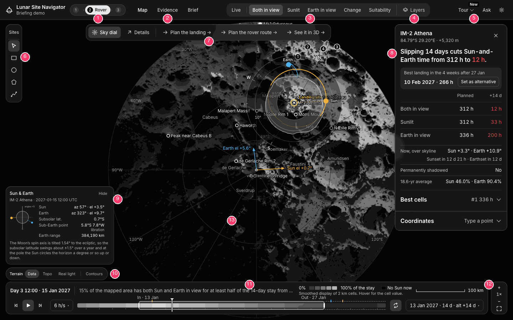
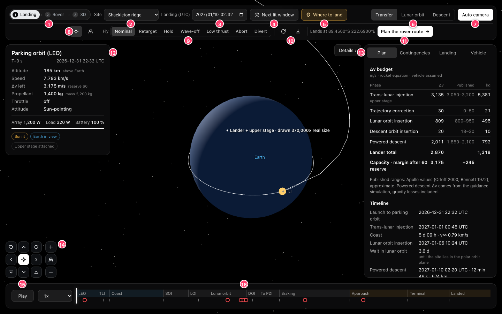

# Lunar Landing Site Navigator: user guide

*Team Unscheduled Burn, NASA Space Apps Challenge 2026, Bristol, 14–15 November 2026.*

A planning tool for **landing and driving at the lunar south pole**, built on NASA's LOLA terrain and the real
positions of the Sun and Earth (JPL Horizons). It runs in the browser, offline, from this repository. Every screenshot
in this guide is the real software, taken on 14 November 2026 at 1440 × 900.

## One mission, three steps

Every page has the same stage bar. The site and landing time you choose travel with you, and the touchdown point
becomes the rover's start.

| Step | Page | You decide | Chapter |
|---|---|---|---|
| **1 Landing** | `lander.html` | Where and when to land: the trajectory, fuel, descent and landing checks, contingencies, and a planner that finds landable ground | [Lander](guide/lander.md) |
| **2 Rover** | `index.html` | Is the site good for the whole stay, and how robust to a slip? Then the drive: routes, slope limits, battery, radio, safe havens | [Navigator: sites](guide/navigator.md) · [Navigator: routes](guide/navigator-route.md) |
| **3 3D** | `globe.html` | What the terrain and the drive look like: the whole Moon in 3D, the rover at real size along the route | [3D globe](guide/globe.md) |

## Start in one minute

1. Run a static server from the repository: `python3 -m http.server 8731 --directory demo`, then open
   http://localhost:8731/ (or open `demo/index.html` straight from the files).
2. The navigator opens on the IM-2 Athena site, landing 13 Jan 2027, 14-day stay. The **site card** on the right
   already answers the first question: a 14-day slip would cut the hours with Sun and Earth both in view from 312 to 12.
3. Press **Tour** for a two-minute story, or follow a use case below.

## Contents

* **[Navigator: site analysis](guide/navigator.md)** — map modes (Live, Both in view, Sunlit, Earth in view, Change,
  Suitability), Layers, terrain styles (Data, Topo, Real light) and contours, the Sun & Earth readout, the site card,
  sky dial, Details (overview, power, comms, compare), time bar and landing slip, best cells, regions, the site list,
  Evidence, Brief, Tour, Ask, Settings.
* **[Navigator: rover routes](guide/navigator-route.md)** — three candidates, mobility limits, one-way stretches and
  traps, battery simulation and departure search, comms along the route, safe havens, the self-driving B-RRT\*
  planner, slope colours, the 3D preview window, the mission file (save, load, JSON, GeoJSON, CSV).
* **[3D globe](guide/globe.md)** — whole-Moon terrain, camera controls, contours and height colours, the route view
  (real-size rover, attitude, minimap, elevation profile, follow camera, no-go volumes, leg labels, self-driving
  search, recording), waypoints, the Mapped layer.
* **[Lander](guide/lander.md)** — Earth to orbit to powered descent, the 3D lander, the descent map, the Δv budget and
  timeline, contingency branches, landing checks, the landing-site planner (pick, scores, better spots, Land here).
* **[How NASA plans a lunar landing](NASA-MISSION-PLANNING.md)** — the project life cycle, how Artemis landing regions
  and sites are chosen, trajectory design, landing accuracy, CLPS robotic landers, surface operations; for each, which
  part of this tool does it and what it simplifies. With sources.
* **[Glossary](guide/glossary.md)** — PSR, skyline, libration, NRHO, Δv, ellipse, B-RRT\* and more, in plain words.
* **[Troubleshooting and FAQ](guide/faq.md)** — no data north of 80°S, dates outside 2026–2028, slow first load,
  cleared storage.
* Reference: [VARIABLES.md](VARIABLES.md) (every number the tool uses and its source), [LANDER.md](LANDER.md)
  (lander physics), [PHASES.md](PHASES.md) (how it was built).

## Which tool answers which question

| Question | Where | How |
|---|---|---|
| How many hours of sunlight and of Earth will a site get during the stay? | Navigator, site card | Select the site; read *Both in view*, *Sunlit*, *Earth in view* |
| What if the landing slips a week or two? | Navigator, site card / *Change* mode | Set the slip on the time bar; the card shows planned vs slipped, Change colours the losers red |
| Which ground near the pole is best for a long stay? | Navigator, *Suitability* + Best cells | Adjust weights and filters in Layers; open Best cells |
| Where exactly are the Sun and Earth now, and when do they set? | Navigator, Sun & Earth readout, sky dial, Details | Azimuth and elevation above the skyline; rises and sets table |
| Will a battery last the stay? | Navigator, Details → Power; Layers → Longest dark | Hours with the battery empty, battery needed |
| How good is the radio link (Earth, relay)? | Navigator, Details → Comms | Earth direct, example relay, longest blind spell |
| Which of two areas is better? | Navigator, regions A and B | Draw both, compare side by side |
| Can a rover drive from the landing site to a point, and which way? | Navigator, route card | Three candidates under the slope limits; one-way and trap ground |
| When should the rover leave so the battery holds? | Route action bar, the departure time | Its menu: *Find good departure times*, then pick one |
| Is the rover always in touch? | Route card, rover summary | Station link, Earth in view, gaps |
| Where does it shelter if something goes wrong? | Route card, *If something goes wrong* | Safe havens and a comms-denied heading |
| How close is the rover to tipping, and where? | Globe, route view | Attitude panel along the profile |
| How much fuel does the landing take, and is there margin? | Lander, *Plan* | Δv budget against Apollo values |
| Is the touchdown spot flat, lit and in contact with Earth? | Lander, *Landing* | Landing checks on the 5 m terrain |
| Where nearby could we land instead? | Lander, *Where to land* | Landable map, better spots, *Land here* |
| What if the engine underperforms or lidar sees a hazard? | Lander, *Fly* branches | Abort, low thrust, divert, wave-off, hold, retarget |
| How does NASA really decide? | [NASA-MISSION-PLANNING.md](NASA-MISSION-PLANNING.md) | The process, criteria and sources |

## Worked use cases

| Use case | Chapter |
|---|---|
| Is IM-2's landing date robust to a two-week slip? | [Navigator A](guide/navigator.md#use-case-a-is-im-2s-landing-date-robust-to-a-two-week-slip) |
| Find the best ground for a long stay | [Navigator B](guide/navigator.md#use-case-b-find-the-best-ground-for-a-long-stay) |
| Compare two candidate areas | [Navigator C](guide/navigator.md#use-case-c-compare-two-candidate-areas) |
| A 10 km drive from the Shackleton ridge landing site that keeps Earth in view | [Routes](guide/navigator-route.md#use-case-a-10-km-drive-from-the-shackleton-ridge-landing-site-that-keeps-earth-in-view) |
| Check the drive in 3D | [Globe](guide/globe.md#use-case-check-the-drive-in-3d) |
| Land at the Shackleton ridge on 10 January 2027 | [Lander A](guide/lander.md#use-case-a-land-at-the-shackleton-ridge-on-10-january-2027) |
| Find a better spot near Mons Mouton | [Lander B](guide/lander.md#use-case-b-find-a-better-spot-near-mons-mouton) |

## What is data and what is assumed

**NASA data:** LOLA terrain (whole Moon 7.6 km to 474 m; south pole 240 m to 20 m; 5–20 m patches around the listed
sites), permanently shadowed regions and 18.6-year illumination averages (Mazarico et al.), the Sun and Earth
directions (JPL Horizons, 1 Nov 2026 to 1 Jan 2029), the GRAIL gravity terms. **Assumed** (and labelled so on every
card): the rover's limits, speed, panel, battery and loads; the lander's masses, engine and touchdown limits; the
landing ellipse; radio power and threshold; relay orbits; suitability weights. The tool is a first-look screen, not a
certified landing analysis: slopes come from 5–240 m terrain, so rocks are never seen, and there is no thermal model.
