# 3D globe (`demo/globe.html`)

A 3D globe of the whole Moon from NASA's LOLA elevation, from 7.6 km pixels for the whole Moon down to 20 m at the
south pole and 5–20 m around the landing sites. It is step **3 3D** of the mission flow: it shows the terrain, plays
the planned rover drive with a real-size rover, and keeps track of which terrain we have mapped.

**Back to the [guide](../GUIDE.md)** · Terms: [glossary](glossary.md)

---

## 1. The screen at a glance

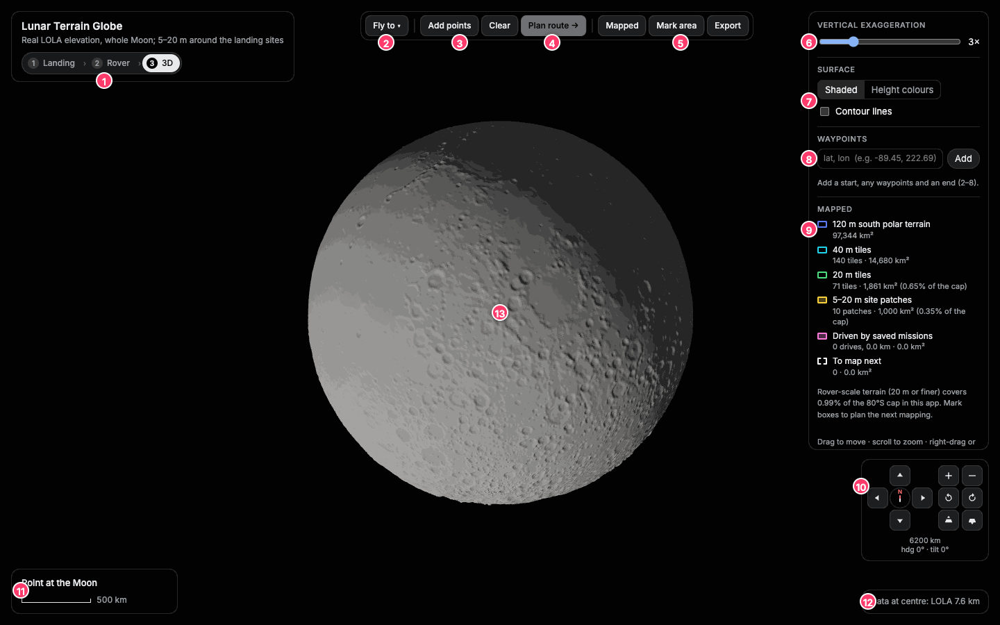

| # | Part | What it does |
|---|---|---|
| 1 | **Title and stage bar** | 1 Landing → 2 Rover → 3 3D, with the mission's site and date once a route is loaded. |
| 2 | **Fly to** | Jump to a preset: Whole Moon, Far side, South pole, Shackleton, Tycho, Apollo 11. |
| 3 | **Add points · Clear** | Click the globe to place waypoints; clear them ([§5](#5-waypoints-plan-on-the-globe-drive-in-the-navigator)). |
| 4 | **Plan route →** | Send the waypoints to the navigator's route card. |
| 5 | **Mapped · Mark area · Export** | Show what terrain the app has; mark 10 × 10 km boxes to map next; download them ([§6](#6-the-mapped-layer)). |
| 6 | **Vertical exaggeration** | Stretch heights (3× by default) so relief is easy to see. Slopes in the panels are always real. |
| 7 | **Surface** | *Shaded* or *Height colours*, and *Contour lines* (interval follows the zoom). |
| 8 | **Waypoints** | Type a latitude and longitude and *Add* (2–8 points: a start, any waypoints, an end). |
| 9 | **Mapped** legend | Terrain resolution on hand and its area. |
| 10 | **Camera controls** | Pan, zoom, turn, tilt, north up ([§2](#2-moving-around)). |
| 11 | **Point at the Moon** | The latitude, longitude and height under the pointer, and a scale bar. |
| 12 | **Data at centre** | Which LOLA product the terrain at the view centre comes from, for example "LOLA 20 m (south pole)" or "LOLA 5 m". |
| 13 | **The globe** | Drag to move, scroll to zoom. |

## 2. Moving around

* **Mouse:** drag to move, scroll to zoom, right-drag to turn and tilt (the hint at the bottom of the side panel lists the gestures).
* **Buttons** (bottom right): pan forward / back / left / right, zoom in / out, turn left / right, tilt towards the
  horizon / straight down, and the compass to turn north up. Under them: the camera distance, heading and tilt.
* **Keys:** arrows pan, Shift + arrows turn and tilt, + and − zoom, N north up.
* Terrain sharpens as you zoom: tiles refine to the finest LOLA level that covers them (no seams between levels).

| Shackleton crater at 20 m | with contour lines | with height colours |
|---|---|---|
| 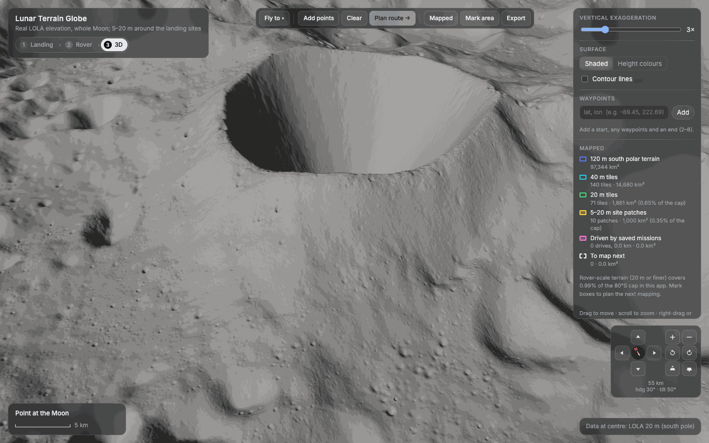 | 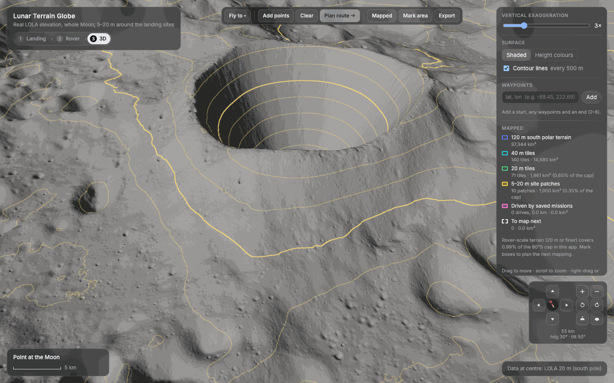 | 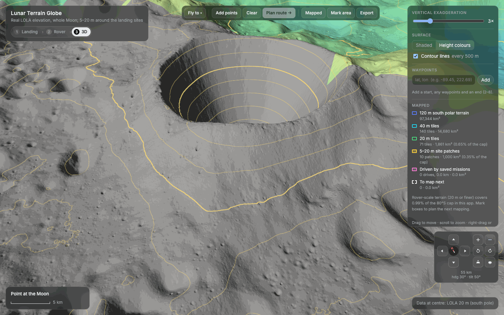 |

**Data.** LOLA GDR global DEMs (LDEM_4, _16, _64) and polar DEMs (240 m to 20 m), plus 10 × 10 km patches at 5, 10 or
20 m around each listed south-pole site (README resource table; [VARIABLES.md](../VARIABLES.md) §1). The 474 m global
tiles are not in the repository; without them the globe uses 1.9 km outside the poles. The light is a display
light, not the real Sun.

## 3. The route view

Press **Fly along in 3D** in the navigator's route card (or **3** in the stage bar after planning a route): the globe
opens on the route with the whole simulated drive.

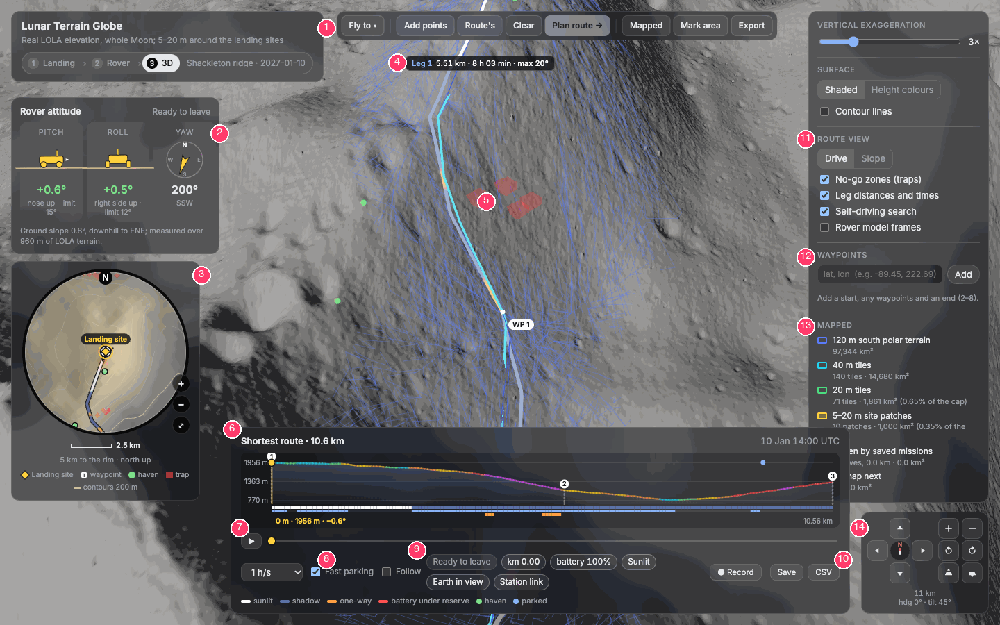

| # | Part | What it does |
|---|---|---|
| 1 | **Action bar** | As above, plus the route's own items. |
| 2 | **Rover attitude** | Pitch (nose up or down, against the climb or descent limit), roll (against the across limit) and yaw (heading), from the terrain under the rover, with the ground slope and the baseline it was measured over. |
| 3 | **Minimap** | Shaded terrain with height tint and contours, the route, numbered waypoints, the landing site (on the rim with its distance when off the map), havens, traps, a scale bar. Zoom buttons. |
| 4 | **Leg labels** | Each leg's distance, drive time and steepest grade. |
| 5 | **No-go volumes** | Trap ground drawn as red blocks. |
| 6 | **Elevation profile** | Height along the route coloured by slope, numbered waypoints, strips for sunlit, shadow, one-way, battery under reserve. Click or drag it to move the rover. |
| 7 | **Play and scrubber** | Play / pause; the scrubber runs by distance and lines up with the profile. |
| 8 | **Speed · Fast parking · Follow** | Playback speed (1 h/s and up; parked time runs faster with *Fast parking*); *Follow* rides behind the rover. |
| 9 | **State chips** | Driving / parked / ready, km, battery, sunlit or in shadow, Earth in view, station link. |
| 10 | **Record · Save · CSV** | Record the rover's motion, save it with the route in the navigator's Mission file, or download it as CSV. |
| 11 | **Route view options** | Colour by *Drive* (sunlit, shadow, one-way, under reserve, not reached) or *Slope*; *No-go zones (traps)*; *Leg distances and times*; *Self-driving search*; *Rover model frames*. |
| 12 | **Waypoints** | Add more points here to re-plan. |
| 13 | **Mapped** legend | As on the start screen. |
| 14 | **Camera controls** | As above. |

The rover model is a six-wheeled rover drawn at **real size (2.2 m long, assumed)**. While it is smaller than about
18 pixels a ring marks where it is; when terrain hides it the follow camera tilts down and an outline shows it
through the ground.

| Follow camera | Rover model frames | No-go volumes and leg labels | Self-driving search |
|---|---|---|---|
| 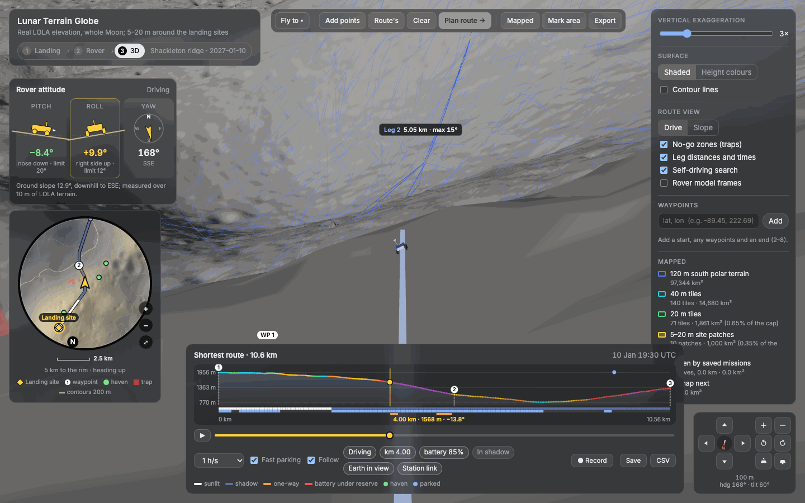 | 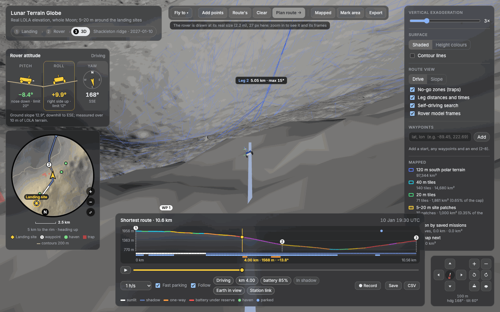 |  | 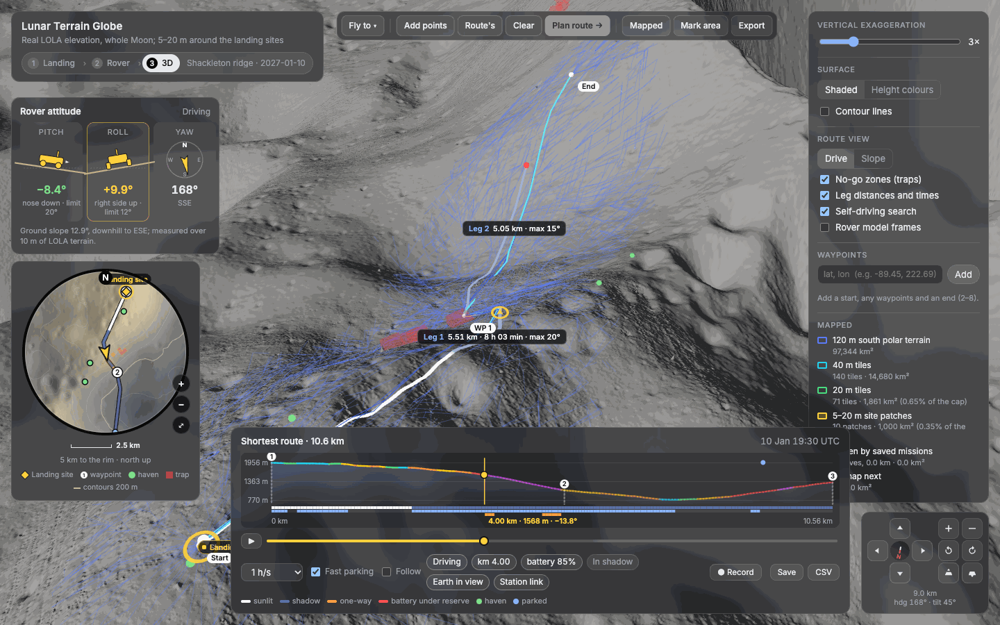 |

*Rover model frames* shows the model's axes (x forward, y left, z up). *Self-driving search* draws the B-RRT\*
planner's trees and candidate paths when the route was planned with *Self-driving* in the navigator.

## 4. Recording

**Record** samples the rover's motion while it plays: time, position, km, height, pitch, roll, yaw, battery and flags,
one sample per 30 s of drive time (at most about 3,000). **Save** puts the recording with the route into the
navigator's *Mission file*; **CSV** downloads it.

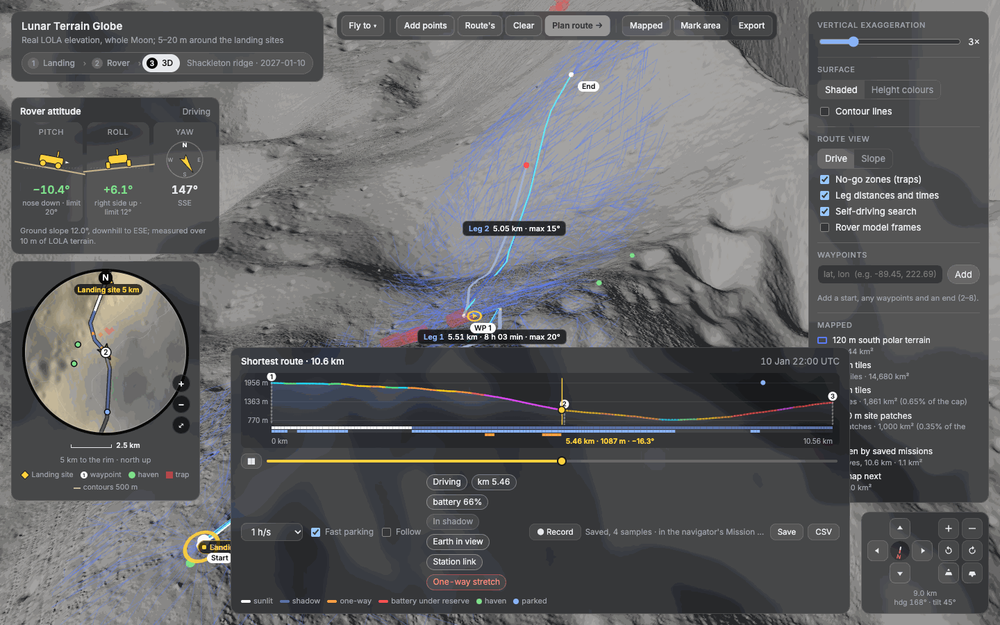

## 5. Waypoints: plan on the globe, drive in the navigator

**Add points** and click the globe, or type points in *Waypoints* (for example `-89.45, 222.69`). The list shows each
point with its height and the distance from the previous one. **Plan route →** opens the navigator's route card with
those points (as `rp=` in the link), ready to plan.

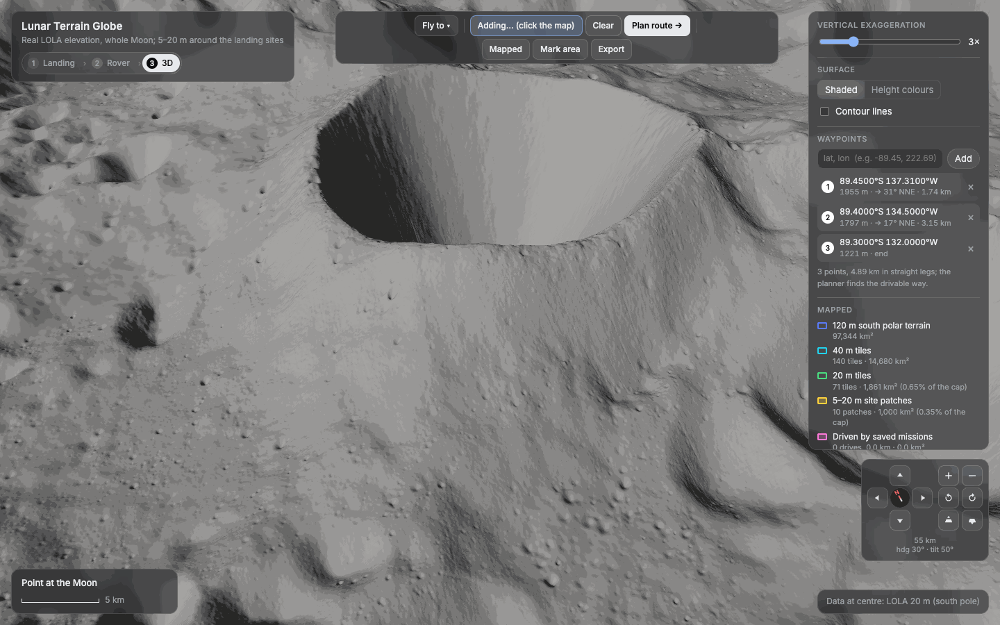

## 6. The Mapped layer

**Mapped** colours the terrain the app already has, by resolution: the 120 m south polar square (97,344 km²), 140 tiles
at 40 m (14,680 km²), 71 tiles at 20 m (1,861 km², 0.65 % of the 80°S cap) and the 5–20 m site patches (10 patches,
1,000 km²); plus the ground covered by saved drives (route length × an assumed 0.1 km camera swath) and the boxes
marked to map next. Rover-scale terrain (20 m or finer) covers about 1 % of the cap. **Mark area** adds 10 × 10 km
boxes (kept in the browser); **Export** downloads them as JSON.

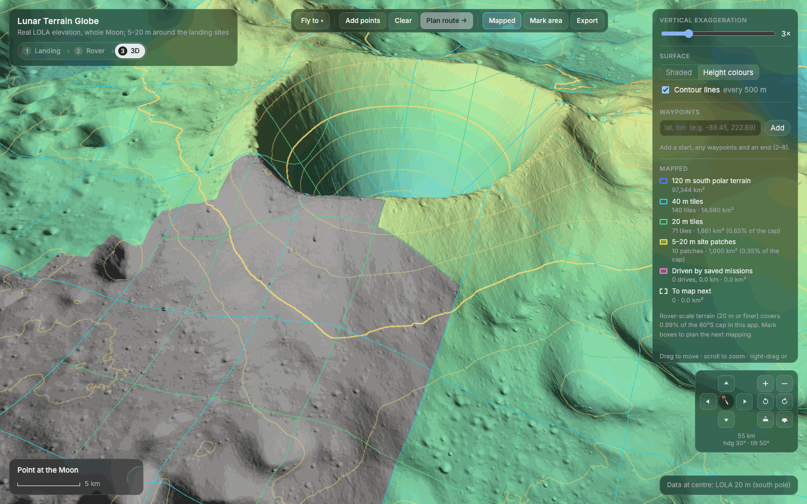

## 7. On a phone

The panels stack and the playback bar goes under them.

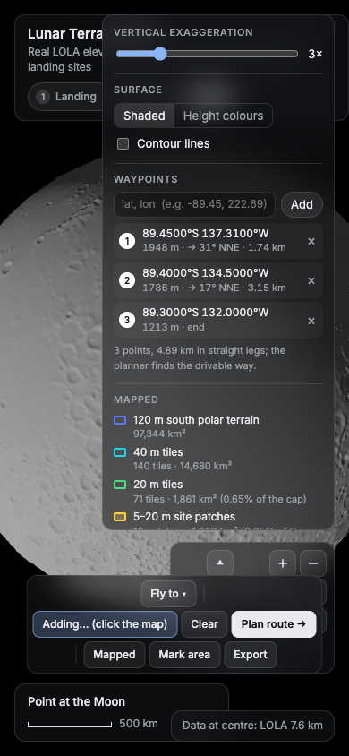

---

## Use case: check the drive in 3D

*Question: the navigator's route from the Shackleton ridge looks fine on the map. What does the ground under the rover
look like, and where is it closest to tipping?* (Continues [the route use case](navigator-route.md#use-case-a-10-km-drive-from-the-shackleton-ridge-landing-site-that-keeps-earth-in-view).)

1. In the navigator's route card, choose the **Short** route and press **Fly along in 3D**. The globe opens on the route,
   the stage bar reads *3 3D · Shackleton ridge · 2027-01-10*.
2. Look at the **elevation profile**: the route drops from about 1,956 m to 770 m and climbs back. The orange stretches
   in its strip are the one-way ground.
3. **Drag the profile** to the steep middle section and turn on **Follow**. At about km 4 the attitude panel reads
   roll **+9.9°** against the 12° across limit, with the ground slope 10.1° measured over 10 m of LOLA terrain: the
   closest the rover comes to its sideways limit.
4. Turn on **No-go zones** and **Leg distances**: the red blocks next to the route are trap ground; the first leg is
   5.51 km, 8 h 03 min, max 20°.
5. Turn on **Self-driving search** to see where the planner looked; its cyan path keeps further from the red ground.
6. **Record** a stretch and **Save**: the recording goes into the navigator's Mission file with the route.
7. **Decide.** If the roll margin is too thin for your rover, go back with **2 Rover**, add a waypoint to steer around
   that slope, or lower the *Across* limit and plan again.

Limits: the attitude comes from the DEM under the rover over two pixels of the finest terrain loaded (10 m on 5 m
data), so rocks and steps are not there; the route's drive times and battery come from the navigator's simulation.
