# Lander (`demo/lander.html`)

The lander page follows a **generic robotic lander** (assumed numbers, not a real spacecraft) from Earth parking orbit
through lunar orbit to a powered descent at a south-pole site, with its fuel budget, power and attitude, landing
checks against the real terrain and contingency branches. It also has a planner for **choosing where to land**. It is
step **1 Landing** of the mission flow: the touchdown point it computes becomes the rover route's start.
The physics and every number's source are in [LANDER.md](../LANDER.md).

**Back to the [guide](../GUIDE.md)** · Terms: [glossary](glossary.md)

---

## 1. The screen at a glance

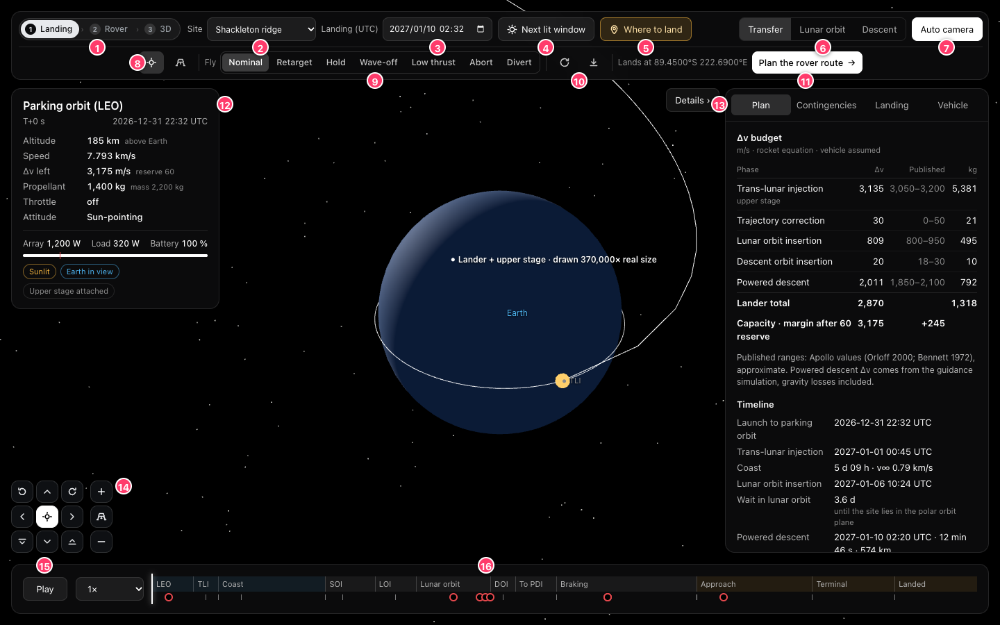

| # | Part | What it does |
|---|---|---|
| 1 | **Stage bar** | 1 Landing (this page) → 2 Rover → 3 3D. |
| 2 | **Site** | A listed site, or a custom point (from the planner or a link `?site=lat,lon`). |
| 3 | **Landing (UTC)** | The requested landing time. The planner moves touchdown by up to half an orbit to meet an overhead pass. |
| 4 | **Next lit window** | Move the landing to the next time the site is lit long enough to land (an hourly search against the skyline). |
| 5 | **Where to land** | Open the landing-site planner ([§5](#5-choosing-where-to-land)). |
| 6 | **Scene** | *Transfer* (Earth–Moon), *Lunar orbit*, *Descent*. The scene also follows the timeline by itself. |
| 7 | **Auto camera** | Let the camera frame each phase. |
| 8 | **Follow craft · Look at the lander** | Re-centre on the craft; open a real-size close-up of the lander. |
| 9 | **Fly** | Which branch to fly: *Nominal*, or a contingency: *Retarget*, *Hold*, *Wave-off*, *Low thrust*, *Abort*, *Divert* ([§4](#4-contingency-branches)). |
| 10 | **Replan · Save plan** | Re-run the plan after changing the vehicle; download the plan. |
| 11 | **Lands at … · Plan the rover route →** | The touchdown point of the branch being flown; open the navigator's route card from it. |
| 12 | **HUD** | Phase, mission time and UTC, altitude, speed, Δv left, propellant and mass, throttle, attitude, array power, load, battery, Sun and Earth in view. |
| 13 | **Details and panel tabs** | *Plan*, *Contingencies*, *Landing*, *Vehicle* ([§3](#3-the-panels)). |
| 14 | **Camera controls** | Rotate, raise or lower, pan, zoom; centre button = follow. Keys: + / − zoom, Q / E rotate, R / F raise / lower, W A S D pan, 0 follow, L look at the lander. |
| 15 | **Play and speed** | Play the mission at 0.5–4× or *Real time* (space bar plays). |
| 16 | **Timeline** | Every phase (LEO, TLI, coast, SOI, LOI, lunar orbit, DOI, to PDI, braking, approach, terminal, landed) with event ticks and red contingency markers. Click or drag to jump. |

## 2. The three scenes

| Transfer (true scale) | Lunar orbit (Moon-centred) | Descent: approach, with contours |
|---|---|---|
|  | 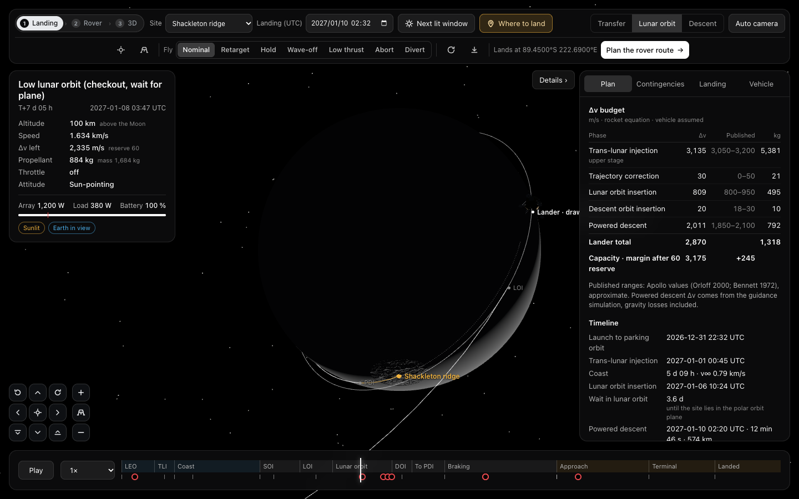 | 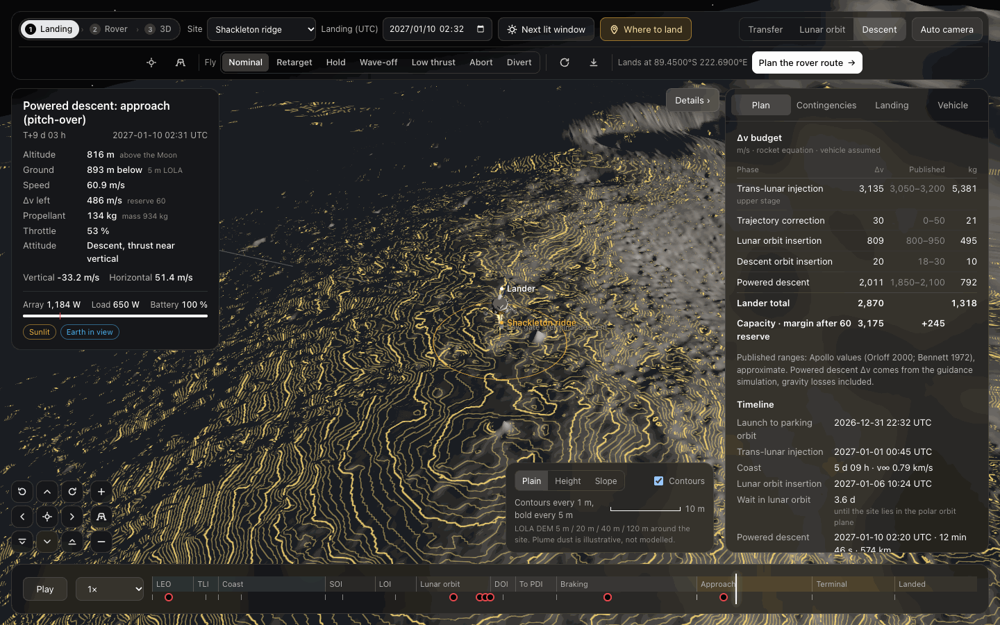 |

* **Transfer** — Earth-centred, true scale. The lander and upper stage are drawn enlarged, with the factor in the label
  ("drawn 370,000× real size").
* **Lunar orbit** — Moon-centred; the Moon turns under the fixed 100 km polar orbit until the site lies in its plane
  (the "wait in lunar orbit"), with LOLA relief on the polar cap.
* **Descent** — local metres on the LOLA terrain around the site (5 m at Shackleton ridge), with the Moon's curvature
  and the real Sun and Earth directions, so the low polar Sun throws long shadows. The HUD shows the height above the
  ground directly below and that terrain's resolution.

**Descent map.** The terrain key (bottom right in Descent) colours the ground *Plain*, by *Height* relative to the
landing site, or by *Slope* (red where steeper than the lander's 10° limit), and draws contour lines (every 1 m,
bold every 5 m, close in). Below about 25 m a sheet of dust blows out under the engine and a ring marks contact: both
are **illustrative**, there is no plume–soil model.

| Terminal descent | Slope colours | Height colours | Landed |
|---|---|---|---|
| 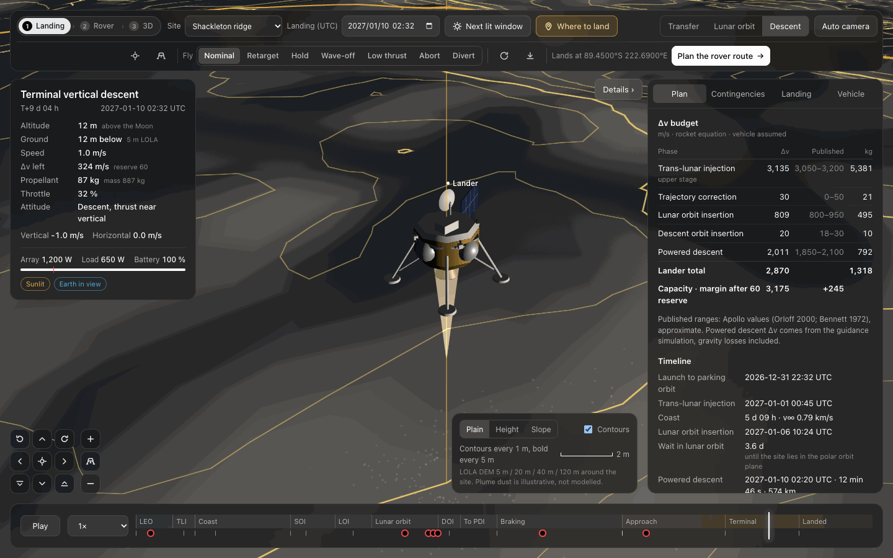 | 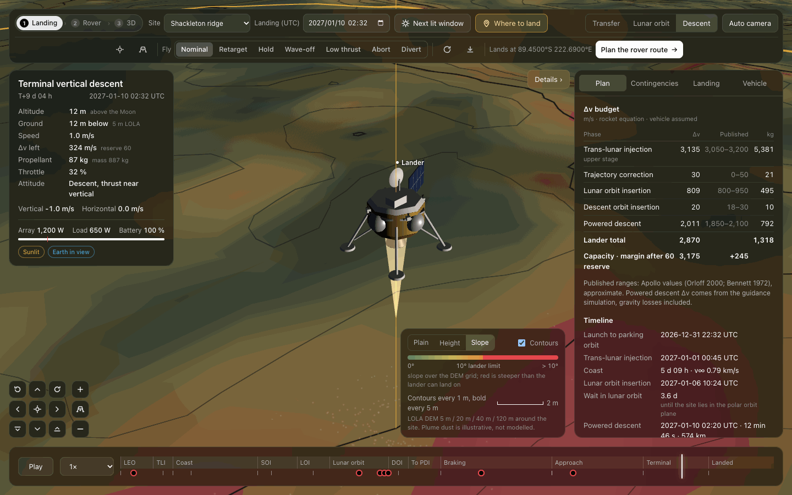 | 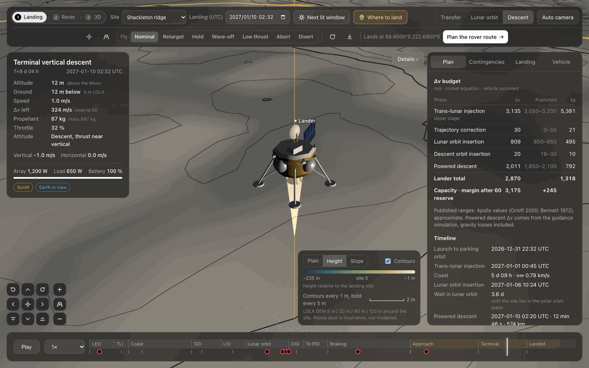 | 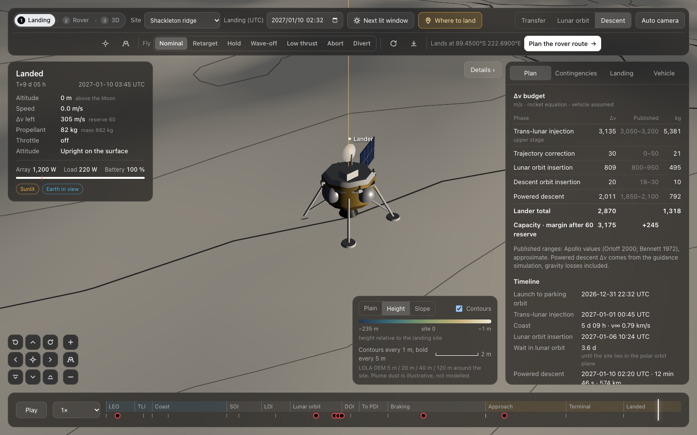 |

**The lander model** (4.9 m across the footpads, 3.3 m tall, assumed) is drawn at its attitude in every view: in burns
its axis is along the thrust and the solar array turns to the Sun; landed it stands upright with the array tracking
the Sun and the dish pointed at Earth. **Look at the lander** opens a real-size close-up in the Vehicle tab, lit from
the Sun's direction, with lines to the Sun (yellow) and Earth (blue) and the parts labelled.

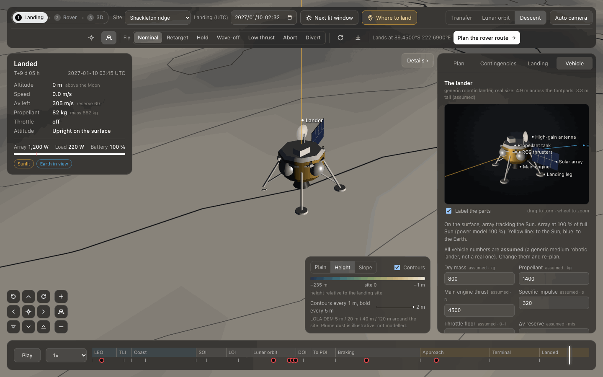

## 3. The panels

| Plan | Contingencies | Landing | Vehicle |
|---|---|---|---|
| 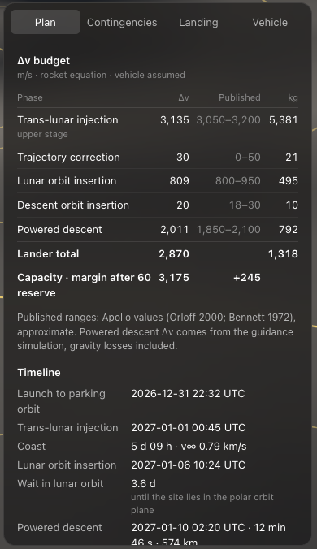 | 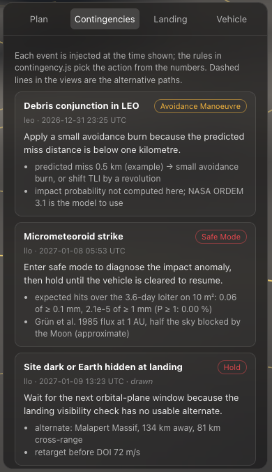 | 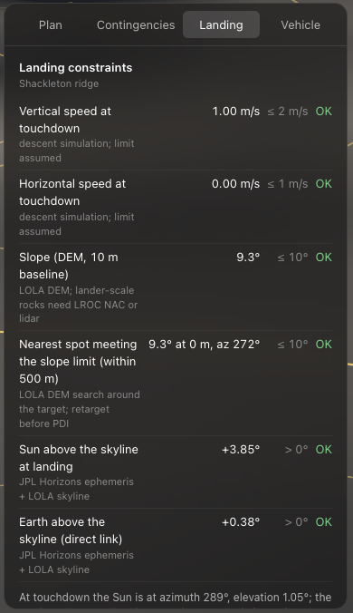 | 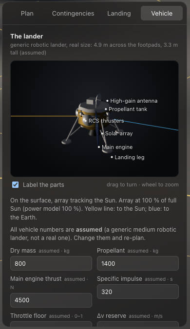 |

* **Plan** — the **Δv budget** by phase with published Apollo ranges next to it and the propellant used (rocket
  equation, vehicle assumed), the capacity and the margin after a 60 m/s reserve; then the **timeline** of the mission
  with dates.
* **Contingencies** — each event injected at its time, the action the rules choose and why, with its numbers (Δv, delay,
  alternate site). Dashed lines in the views are the alternative paths.
* **Landing** — the landing constraints at the touchdown: vertical and horizontal speed, slope on the finest DEM (10 m
  baseline on 5 m data), the nearest spot within 500 m that meets the slope limit, Sun and Earth above the skyline.
  Lander-scale rocks are not in the DEM (LROC NAC images or lidar would be needed).
* **Vehicle** — the close-up and every vehicle number, all labelled *assumed*: dry mass, propellant, thrust, specific
  impulse, throttle floor, Δv reserve, array, battery, loads, touchdown limits. Change them and press **Replan** in the action bar (it lights up once the numbers differ from the plan). The tab
  holds inputs only; the plan's actions are all in the bar.

## 4. Contingency branches

The **Fly** choices in the action bar switch the flown branch; the timeline, views, HUD and the touchdown follow it:

| Branch | What happens |
|---|---|
| *Nominal* | The planned descent. |
| *Retarget* | Before descent: the site is dark or Earth is hidden, so retarget to the nearest lit candidate (or hold). |
| *Hold* | Wait in orbit for the next orbital-plane window. |
| *Wave-off* | No ground GO before descent: fly one more orbit. |
| *Low thrust* | Engine 20 % low: a longer burn that still lands. |
| *Abort* | Engine 45 % low during braking: abort back to a 15 × 31 km orbit (no touchdown). |
| *Divert* | Lidar sees a hazard during approach: divert about 150 m (assumed divert reach). |

| Abort to orbit | Hazard divert |
|---|---|
| 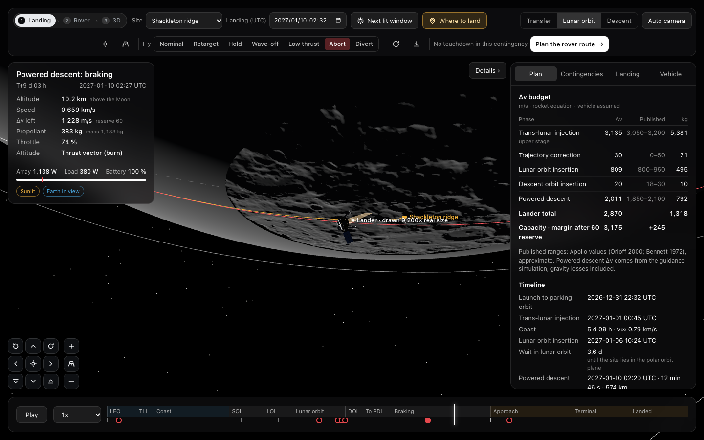 | 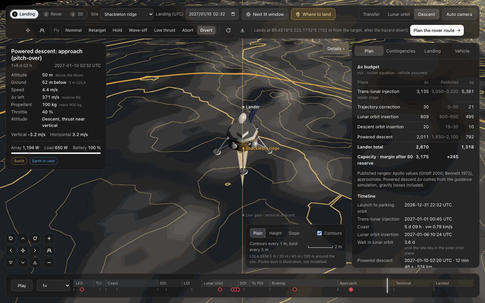 |

These are screening decisions from `contingency.js`, not flight software. A branch that does not land clears the
touchdown point, so the rover step has no start until you fly a branch that lands.

## 5. Choosing where to land

**Where to land** opens a full-screen planner over the south polar map (LOLA relief, PSR outlines, the listed sites).

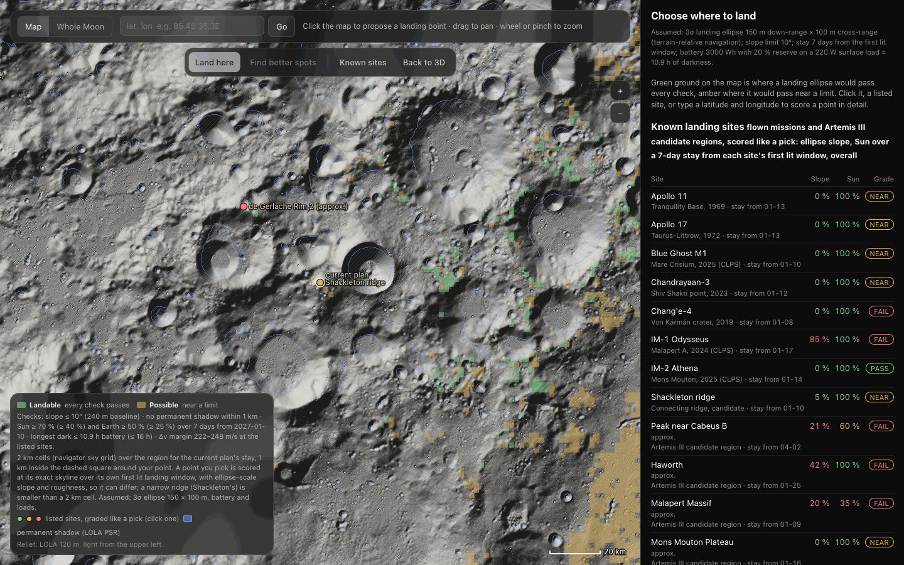

* **Before you pick**, the map shades every 2 km cell inside 80°S **green** where a landing would pass every check and
  **amber** where it passes near a limit, for the current stay. The checks: slope ≤ 10° (240 m baseline), no permanent
  shadow within 1 km, Sun ≥ 70 % and Earth ≥ 50 % of the stay, longest dark spell ≤ the battery's hours, Δv margin ≥ 0.
  The **listed sites** are graded the same way (pass / near / fail dots and a table).
* **Pick a point** by clicking the map, clicking a site, or typing a latitude and longitude (*Go*). The point is scored
  with an **assumed 3σ landing ellipse of 150 m down-range × 100 m cross-range**: the chance of a safe touchdown (2000
  landings scattered as a Gaussian whose 3σ is the ellipse, each safe on ground within the slope limit and outside
  permanent shadow), roughness (where the DEM is 40 m or finer), share in permanent shadow, hours of Sun and of Earth over the stay
  from the point's first lit window, the longest dark spell against the battery (3000 Wh, 20 % reserve, 220 W = 10.9 h,
  assumed), Earth in view at touchdown, and the lander's Δv margin. Each gets *pass*, *near* or *fail* and one verdict
  sentence sums them up.
* **Better spots nearby**: a square of twice the search radius (30 × 30 km by default) around the point is screened with
  the navigator's suitability score; the eight best passing points at least 2 km apart are scored in full and the five
  with the fewest failed checks (then fewest near, then suitability) are numbered on the map and in a table. When fewer
  than eight pass, the nearest misses on usable ground (slope and permanent shadow pass, shortest dark spell first) fill
  the list, marked ≈, and the card says how many points failed each limit and what battery the shortest night needs.
  In the Map's Where to land, with a mission window set, every place is scored for the planned landing (its first lit
  window within two days of it), and a region also screens the listed sites inside it. **Slip robustness** (default 3
  days) checks the stay from each landing day up to that many days late: the screen picks the places that still pass
  on the most of those days first, and each spot gets a "Landing up to N days late" grade (every day passes, at least
  half, or fewer).
* The **action bar** of the planner: **Land here** (plan the whole mission to the chosen point and its first lit
  landing window), **Find better spots**, the candidates (*Yours*, 1–5), **Known sites**, **Back to 3D**.
* **Whole Moon** switches to a global map (LOLA 7.6 km, finer where loaded) with the near-side limb and the
  terminator; a click south of 80°S goes back to the polar map, elsewhere it scores on the global terrain.

| Your point and its scores | Better spots | Known sites | Whole Moon |
|---|---|---|---|
| 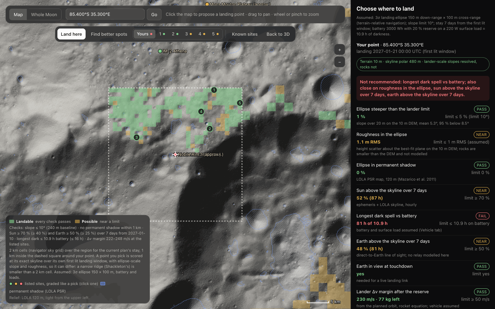 | 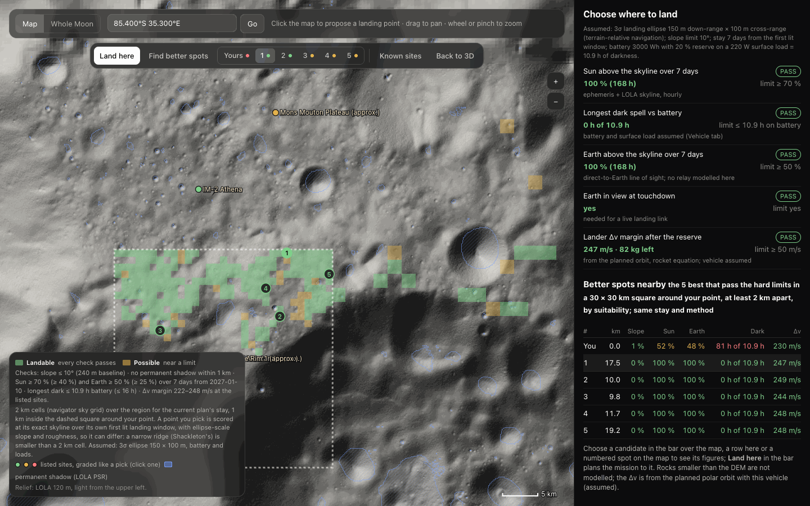 | 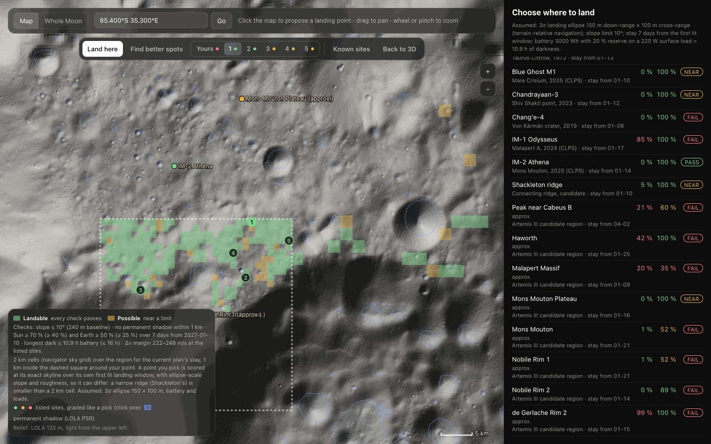 | 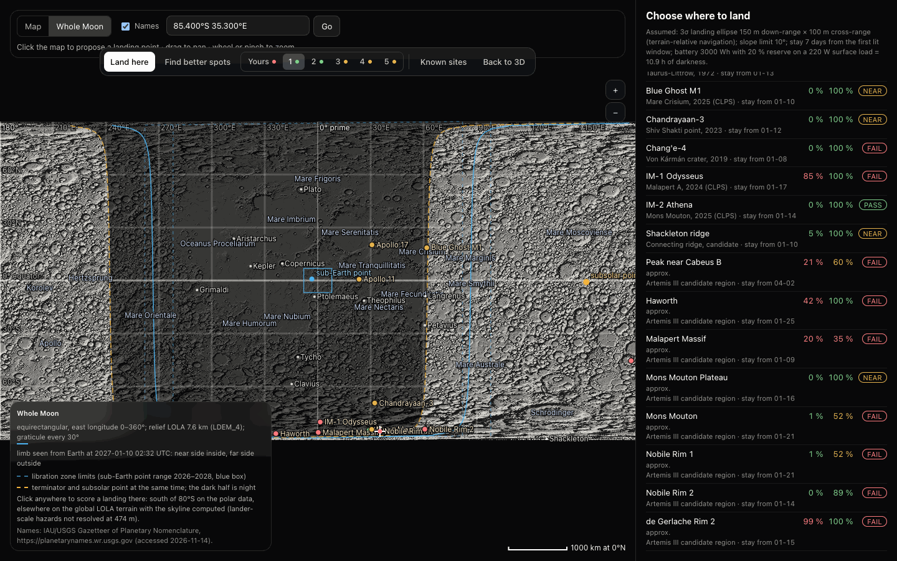 |

## 6. On a phone

The 3D view goes on top and the panels below it.

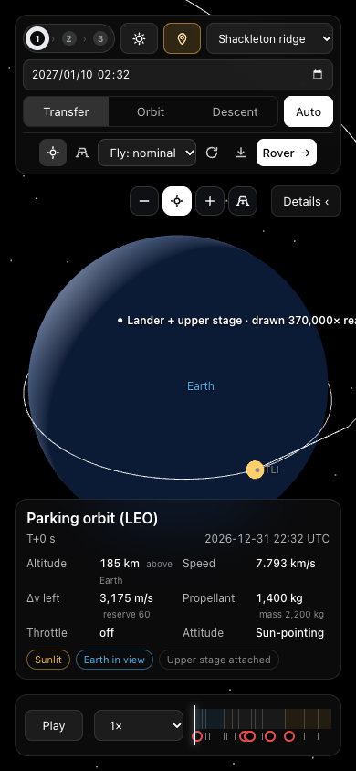

---

## Use case A: Land at the Shackleton ridge on 10 January 2027

1. Open `lander.html?site=shackleton&t=2027-01-10T02:00Z` (or choose **Shackleton ridge** and type the time). The plan
   is computed at once: launch to parking orbit 31 Dec 2026 22:32 UTC, TLI 1 Jan 00:45, 5 d 09 h coast, lunar orbit
   insertion 6 Jan 10:24, 3.6 days waiting until the site lies in the polar orbit's plane, powered descent from
   10 Jan 02:20 (12 min 46 s, 574 km), touchdown 02:32 UTC, about half an hour after the requested time to meet the
   overhead pass.
2. Read the **Plan** tab: lander Δv 2,870 m/s (powered descent 2,011 m/s, inside Apollo's published 1,850–2,100 m/s),
   capacity 3,175 m/s, **margin +245 m/s** after the 60 m/s reserve. The plan closes with this assumed vehicle.
3. Press **Play** (or click *Approach* on the timeline) and switch to **Descent**: the lander pitches over above the
   ridge, the contour lines show the terrain below; at the end the terminal descent comes straight down at 1 m/s.
4. Read the **Landing** tab: touchdown 1.00 m/s vertical and 0.00 m/s horizontal (limits 2 and 1 m/s, assumed), slope
   **9.3°** on the 5 m DEM against the 10° limit (OK but close), Sun **+3.85°** and Earth **+0.38°** above the
   skyline. Earth is barely up: the radio link at touchdown is marginal.
5. Try a contingency: **Fly → Abort**. The braking burn stops and the lander climbs back to orbit; *Lands at* shows no
   touchdown. **Divert** lands about 150 m from the target instead.
6. **Decide and hand on.** Fly *Nominal* again and press **Plan the rover route →**: the navigator opens with the
   touchdown point as the route's start ([route use case](navigator-route.md#use-case-a-10-km-drive-from-the-shackleton-ridge-landing-site-that-keeps-earth-in-view)).

## Use case B: Find a better spot near Mons Mouton

1. Press **Where to land**. Green and amber cells show where a landing could work over the stay.
2. Type `85.40S 35.30E` (the Mons Mouton area) and *Go*. The verdict: **not recommended**. The point is sunlit 52 % and
   has Earth 48 % of the 7-day stay, and its longest dark spell is **81 h against a 10.9 h battery** (fail); roughness is near its limit, slope and
   Δv pass (230 m/s margin).
3. Look at **Better spots nearby**: spot **1**, 17.5 km away at 84.825°S 34.817°E, passes every check: 0 % of the
   ellipse over 10°, roughness 0.5 m RMS, no permanent shadow, Sun and Earth 100 % of the stay (168 h), no dark spell,
   Earth in view at touchdown, Δv margin 247 m/s, first lit landing 14 Jan 2027 19:00 UTC. Spots 2–5 (10–19 km away)
   are similar.
4. Choose **1** in the action bar and press **Land here**. The page sets a custom site at that point and its first lit
   window, replans the whole mission and stores it for the rover and 3D steps.

Limits: the landing ellipse, battery and vehicle are assumptions; the slope comes from 40 m terrain there (5–20 m at
the listed sites), so rocks are not seen; NASA's own process weighs far more (see
[NASA-MISSION-PLANNING.md §3](../NASA-MISSION-PLANNING.md#3-choosing-where-to-land)).
