# Navigator: rover routes (route card)

Once you know where you land, the route card plans a drive from there: three candidate routes, the rover's slope
limits, a battery simulation in time, radio coverage, safe havens if something goes wrong, and a self-driving
planner. It is step **2 Rover** of the mission flow. The site analysis on the same page is in
[navigator.md](navigator.md).

**Back to the [guide](../GUIDE.md)** · Terms: [glossary](glossary.md)

---

## 1. Open it and draw a route

* From the lander page or the stage bar, **2 Rover** opens the navigator with the route card and the landing site as
  the start.
* Or pick the **Route** tool (bottom of the left toolbar), click the start, any waypoints and the end on the map
  (2 to 8 points), and double-click or press Enter to finish. Backspace removes the last point, Esc cancels.
* Or type the points in the card: latitude and *east* longitude (0–360°).

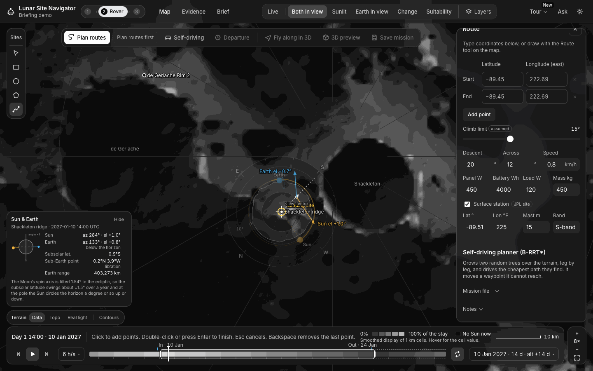

## 2. The route screen

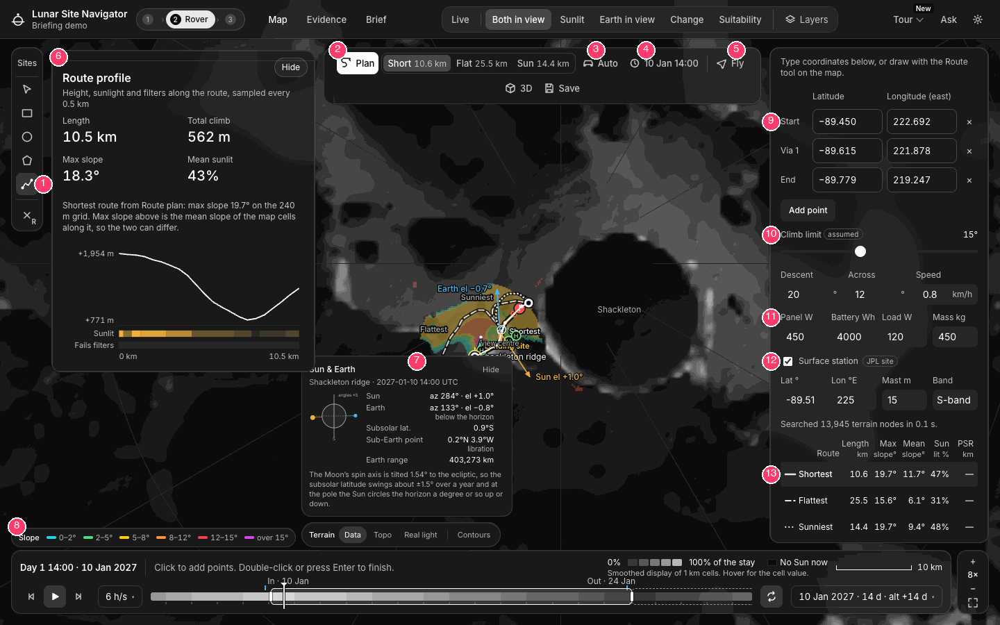

| # | Part | What it does |
|---|---|---|
| 1 | **Route tool** | Draw points on the map; the ✕ under it clears the route. |
| 2 | **Plan routes** and the **candidates** | Plan (or re-plan after changing points or limits). Then choose *Short*, *Flat* or *Sun*, each with its length. |
| 3 | **Self-driving** (Auto) | Run the B-RRT\* planner ([§8](#8-self-driving-planner-b-rrt)). |
| 4 | **Departure time** | When the rover leaves; opens *Leave at the timeline time* and *Find good departure times* ([§5](#5-battery-and-departure-search)). |
| 5 | **Fly along in 3D · 3D preview · Save mission** | Open the route on the globe, show a small 3D window here, save the mission ([§9](#9-3d-preview-and-fly-along), [§10](#10-mission-file-save-load-export)). |
| 6 | **Route profile** | Height along the route every 0.5 km, total climb, max slope, mean sunlit, and strips for sunlit and for failing the map filters. |
| 7 | **Map** | The three candidates (solid, dashed, dotted), the selected one coloured by slope, havens (H), trap ground (red), one-way stretches (orange), the surface station's coverage. |
| 8 | **Slope legend** | 0–2°, 2–5°, 5–8°, 8–12°, 12–15°, over 15° (one scale for the 2D map and the 3D globe). |
| 9 | **Points** | Start, via points, end. *Add point*. |
| 10 | **Rover limits** (assumed) | Climb limit slider (15°), Descent 20°, Across 12°, Speed 0.8 km/h. |
| 11 | **Rover energy** (assumed) | Panel 450 W, Battery 4000 Wh, Load 120 W, Mass 450 kg. |
| 12 | **Surface station** | On/off, latitude, longitude, mast height and band. Defaults are the JPL site on the Connecting Ridge (−89.51°, 225°), 15 m mast, S-band. |
| 13 | **Candidates table** | Length, max slope, mean slope, sunlit share and km inside PSRs for each route. |

## 3. Three candidates

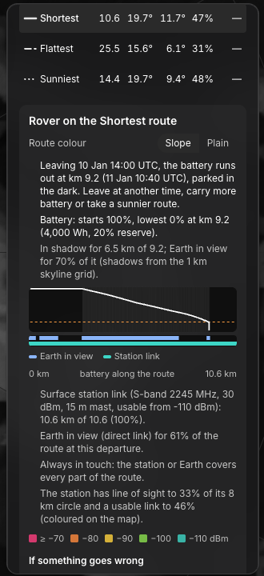

The planner searches the 240 m terrain grid with A\* under the rover's limits and returns:

* **Shortest** — least distance;
* **Flattest** — least slope (it may be much longer);
* **Sunniest** — most of its length lit during the stay.

When two names pick the same route the card says so ("Same route as Flattest"). Slopes are on the 240 m grid:
"Rover-scale slopes are steeper; this cannot tell whether a vehicle can drive the route."

## 4. Mobility: limits, one-way stretches and traps

Every move is checked **by direction**: the grade along the move against the climb and descent limits, the slope
across it against the across limit. So a slope can be fine downhill and impossible uphill. The card reports:

* drive time at the set speed (slower on slopes: half speed at the climb limit, 70 % at the descent limit);
* steepest climb, descent and cross-slope;
* **one-way stretches**: ground steeper downhill than the climb limit, which the rover could not drive back up
  (orange on the map);
* whether **driving back** from the end to the start is possible at all;
* **traps**: ground the rover could drive into but not out of, on to the end or back to the start (red on the map).

Switchbacks are limited to 16 move directions, so some climbable slopes count as one-way (conservative).
Source and code: [VARIABLES.md](../VARIABLES.md) §1, `route-plan.js`.

## 5. Battery and departure search

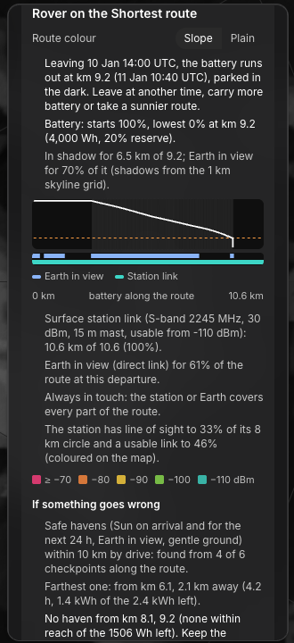

The drive is simulated forward in time from the departure. The rover draws the load plus 180 W to drive plus the
climbing power m·g·v·sin θ ÷ 0.5 (no regeneration downhill). The panel faces the Sun (vertical, turned to its
azimuth) and makes power only where the Sun clears the **local skyline** at that place and time. Below 20 % the
rover parks until it is back to 45 %. The chart shows the battery along the route with shadowed stretches dark, and
two strips under it for **Earth in view** and the **station link**. The map marks **P** where it parks and **!** where
the battery runs out.

The **departure time** in the action bar (it shows the current departure and arrival, or where the battery runs out)
opens a menu:

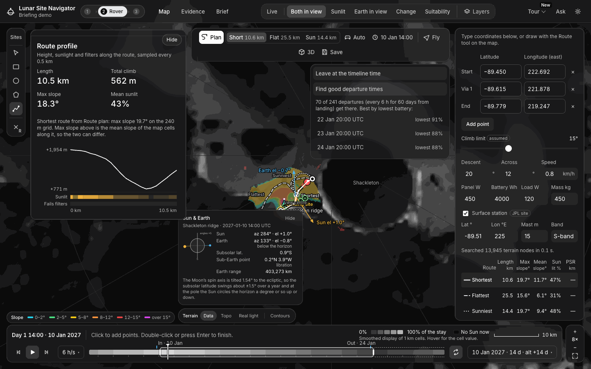

* **Leave at the timeline time** — use the playhead as the departure;
* **Find good departure times** — tries every 6 h for 60 days from landing and lists the best three by lowest battery;
  click one to use it. The card itself has no departure buttons; it shows the result.

All energy figures are assumptions (VARIABLES §3). The skyline grid is 1–2 km, so shadows from small nearby relief
are missed, and there is no thermal model.

## 6. Communications along the route

The card gives the surface station link along the route (free-space loss plus the strongest knife edge in the
terrain between the 15 m mast and the rover's 2 m antenna, ITU-R P.526, with the Moon's curvature), the share with
Earth in view at the simulated times (direct link), the kilometres with no link at all and the longest gap. The map
colours the station's coverage by received power (≥ −70 to −110 dBm). Site, mast, radius, bands and 0 dBi antennas
follow Jun et al. (JPL, IEEE Aerospace 2025); the 30 dBm transmitter and −110 dBm threshold are assumptions
(VARIABLES §4).

## 7. If something goes wrong: safe havens

From a checkpoint every 2 km (and where the battery runs out), the card looks for the nearest **safe haven** by drive
time within 10 km: Sun on arrival and for the next 24 h, Earth in view, ground under 10°, and reachable with the
battery left. Map: green dots where a checkpoint is itself a haven, **H** and a dashed link where it needs a detour,
red rings where there is none. For each it also gives a **comms-denied heading**: the bearing to the haven and where
the Sun and Earth sit relative to it (only bodies above the local skyline), with 2 % dead-reckoning drift.

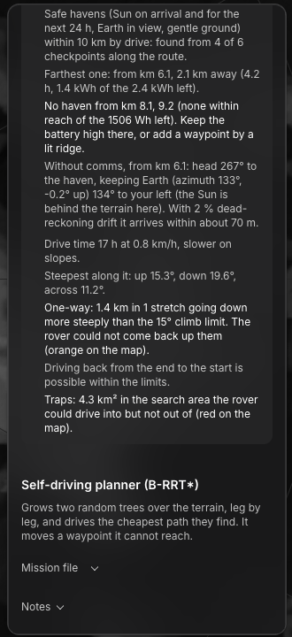

## 8. Self-driving planner (B-RRT\*)

**Self-driving** in the action bar runs a different planner: two random trees grow over the terrain, one from each
end of a leg, under the same direction-dependent limits; when they meet, the connection is improved (RRT\* rewiring)
and the best path is smoothed. If a waypoint cannot be reached it is moved to the gentlest reachable ground nearby;
after five tries the planner stops and returns what it has. The card lists the steps (Start → Select → B-RRT\* →
Path → Add → Goal), the trajectory's length, time and steepest slopes, and how many tree nodes and candidate paths it
used. **Use this path** in the action bar adds it as a fourth candidate; *Show search trees* (in the card) draws the trees (faint blue), candidate paths
(blue) and the chosen trajectory (cyan). It is seeded: the same inputs give the same path.

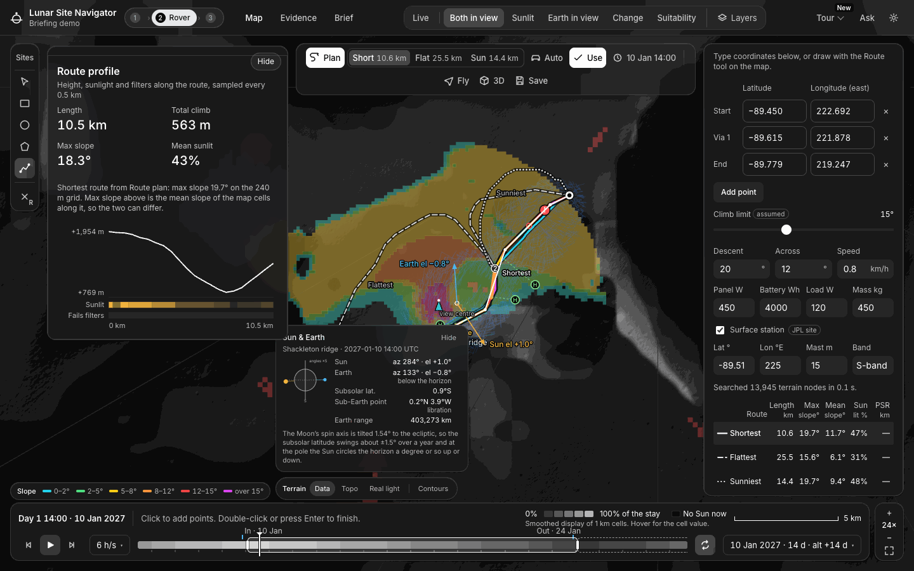

It is a research-style planner in the spirit of Mars rover AutoNav, not NASA software; it does not use sunlight in
its cost (VARIABLES §1).

## 9. 3D preview and fly along

* **3D preview** opens a small globe window at the bottom left of the map with the route draped on the terrain; *Open
  full 3D* goes to the globe.
* **Fly along in 3D** hands the selected route and its whole simulation (time, battery, sunlight, links, one-way,
  parking stops, havens, trap cells, waypoints, the self-driving result) to the globe, which plays the rover along it.
  See [globe.md](globe.md).

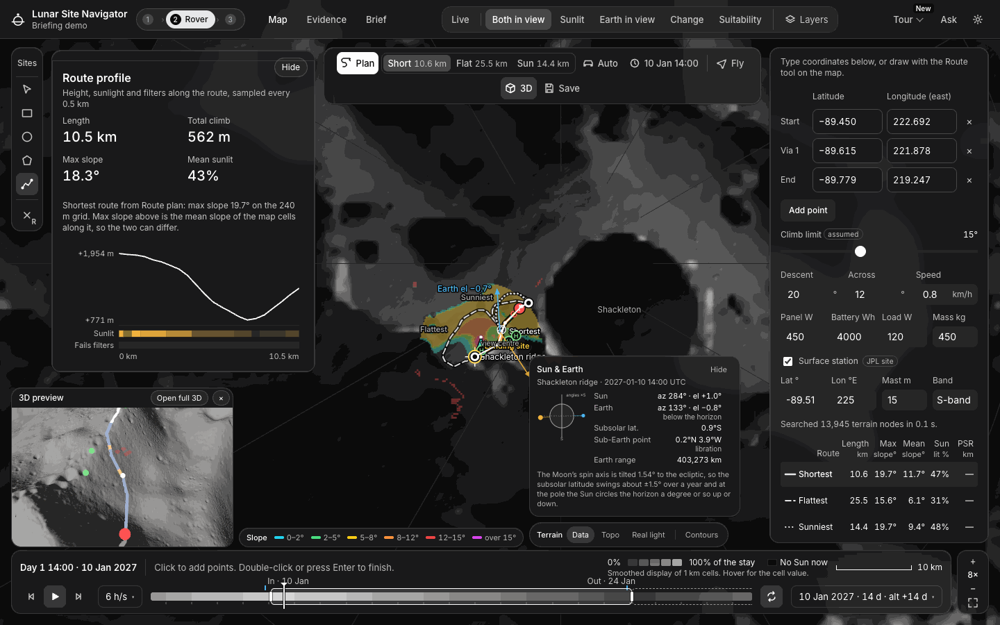

## 10. Mission file: save, load, export

**Save mission** stores the route, the settings, the drive summary and (from the globe) the recorded motion in this
browser (the newest 20). The *Mission file* section lists saved missions with *Load*, *Download* and *Delete*, and
downloads the current one as **JSON** (everything), **GeoJSON** (the route and points, for GIS tools) or **CSV** (the
profile and the simulation per sample). *Import file…* loads a JSON back.

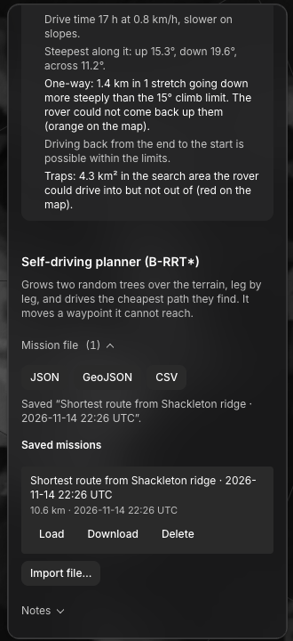

## 11. Route colour by slope

*Route colour* in the rover summary switches the selected route between **Slope** (the six-class slope scale in the
legend) and **Plain**.

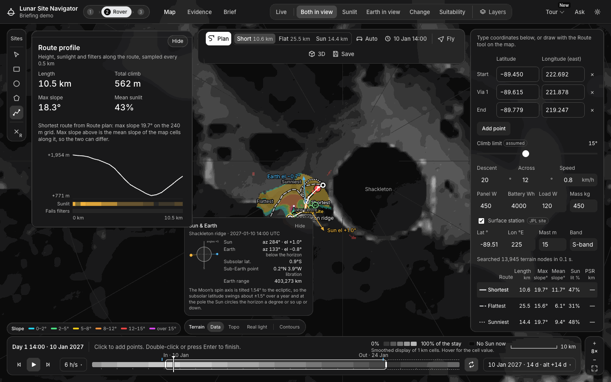

---

## Use case: a 10 km drive from the Shackleton ridge landing site that keeps Earth in view

*Question: after landing on the Shackleton ridge on 10 Jan 2027, we want to drive about 10 km north-east and stay in
radio contact. Which route, and when do we leave?*

1. **Open** the navigator at the landing (from the lander's *Plan the rover route →*, or *Sites → Shackleton ridge*
   with the landing 10 Jan 2027 02:00 UTC, stay 14 days). The ridge itself is excellent: the site card shows the Sun
   up all 336 h of the stay and Earth up 331 h; it is the drive off the ridge that is hard.
2. **Draw** the route with the Route tool: the start on the landing site (−89.450°, 222.692°), one via point and the
   end about 10 km away (−89.779°, 219.247°). Press **Plan routes** in the action bar at the top of the map.
3. **Compare the candidates** in the card's table (the chooser in the bar shows their lengths): *Shortest* 10.6 km (max 19.7°, mean 11.7°, 47 % sunlit), *Flattest*
   25.5 km (15.6°, 6.1°, 31 %), *Sunniest* 14.4 km (19.7°, 9.4°, 48 %). The Flattest is more than twice as long, so
   choose **Short** in the bar's chooser.
4. **Read the rover summary** for the departure at the playhead, 10 Jan 14:00 UTC: *"the battery runs out at km 9.2
   (11 Jan 10:40 UTC), parked in the dark"*: 6.5 km of the drive are in shadow. Earth is in view for 61 % of the route,
   and with the surface station the rover is *always in touch*. Mobility: steepest up 15.3°, down 19.6°, across
   11.2°; 1.4 km is one-way (it could not drive back up), but driving back by another way is possible; 4.3 km² of
   trap ground lies nearby.
5. **Find a better departure.** Click the departure time in the action bar (it reads *Leave 10 Jan 14:00 → battery out
   at km 9.2*) and choose **Find good departure times** in its menu: 70 of 241 departures (every 6 h for 60
   days) get there. The best are 22 Jan 20:00 UTC (lowest battery 91 %), 23 Jan 20:00 and 24 Jan 20:00 (88 %).
6. **Use 22 Jan 20:00**: click it in the same menu. The summary now reads: leaves 22 Jan 20:00, arrives 23 Jan 13:03 after 17 h of driving,
   battery lowest 91 %, ends at 100 %, only 1.1 km in shadow, **Earth in view for 77 % of the route**, station link
   100 %, and a safe haven reachable from all 7 checkpoints.

   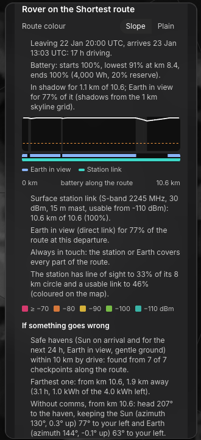
7. **Check it with the self-driving planner** (**Self-driving** in the action bar): it finds a 10.5 km trajectory in 17 h with the steepest
   climb 13.7° (gentler than the A\* route's 15.3°) without moving any waypoint. **Use this path** (in the bar) if you prefer it.
8. **Decide and hand on.** Leave on 22 Jan 20:00 on the Short route (or the self-driving path). **Save mission**, then
   **Fly along in 3D** (both in the action bar) to check the terrain under the rover ([globe.md, use case](globe.md#use-case-check-the-drive-in-3d)).

What this does not tell you: the slopes are on a 240 m grid, so rocks and rover-scale slopes are unknown; the rover's
power figures are assumptions; nothing checks the cold.
