# Navigator: site analysis (`demo/index.html`)

The navigator is the main page: a map of the lunar south pole, from 80°S to the pole, built from NASA's LOLA terrain,
with the real Sun and Earth positions from JPL Horizons. It answers **"if we land here on this date, how many hours
do we get with sunlight and with Earth in view, and what happens if the date slips?"** It is step **2 Rover** of the
mission flow; the rover route card is described in [navigator-route.md](navigator-route.md).

**Back to the [guide](../GUIDE.md)** · Terms: [glossary](glossary.md)

---

## 1. The screen at a glance

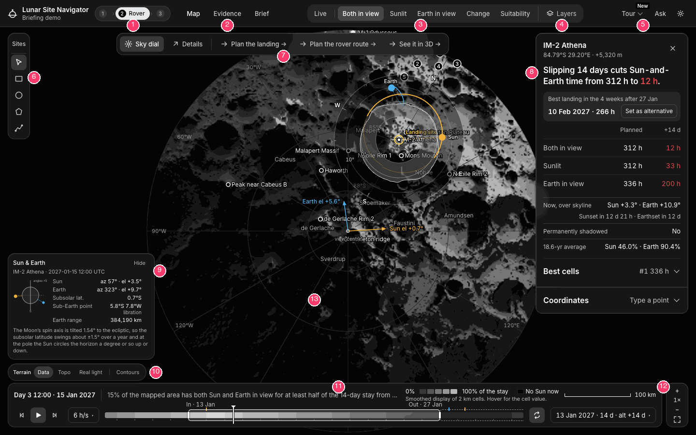

| # | Part | What it does |
|---|---|---|
| 1 | **Stage bar** | 1 Landing (lander page) → 2 Rover (this page) → 3 3D (globe). The site and landing time travel with you. |
| 2 | **Map · Evidence · Brief** | The map; how the figures were checked; the challenge brief and what the tool covers. |
| 3 | **Map modes** | What the colour on the map means: Live, Both in view, Sunlit, Earth in view, Change, Suitability ([§2](#2-map-modes)). |
| 4 | **Layers** | Filters (max slope, longest dark), overlays, suitability weights ([§3](#3-layers)). |
| 5 | **Tour · Ask · Settings** | Guided stories and a tour of the controls, a question panel, display and data settings ([§11](#11-evidence-brief-tour-ask-settings)). |
| 6 | **Sites and drawing tools** | Open the site list; Select, Rectangle, Circle, Polygon (regions) and Route. |
| 7 | **Action bar** | Actions for the open panel. For a site: Sky dial, Details, Plan the landing →, Plan the rover route →, See it in 3D →. For a route or a region it changes to their actions. |
| 8 | **Site card** | The selected point's verdict and figures ([§5](#5-the-site-card)). |
| 9 | **Sun & Earth readout** | Where the Sun and Earth are at the playhead ([§4](#4-terrain-styles-contours-and-the-sun--earth-readout)). |
| 10 | **Terrain chip** | Data / Topo / Real light shading and contour lines. |
| 11 | **Time bar** | Playhead, mission window (In / Out), daily strip, speed, landing and slip ([§7](#7-time-bar-and-landing-slip)). |
| 12 | **Zoom** | +, −, back to the whole map, full screen. Scrolling over the map zooms too. |
| 13 | **Map** | Sites, best cells (numbered), sky dial around the selected site, Sun and Earth arrows at the view centre. |

**How to read the map.** You look down on the south pole. The pole is where the meridian lines meet; latitude rings
are every few degrees (85°S, 88°S). Longitudes are marked around the edge. Click a site or anywhere on the map to
select it; hover to see a cell's value in the bar at the bottom; double-click to zoom in.

On a phone the map comes first and the panels stack under it; the action bar and the time bar stay reachable.

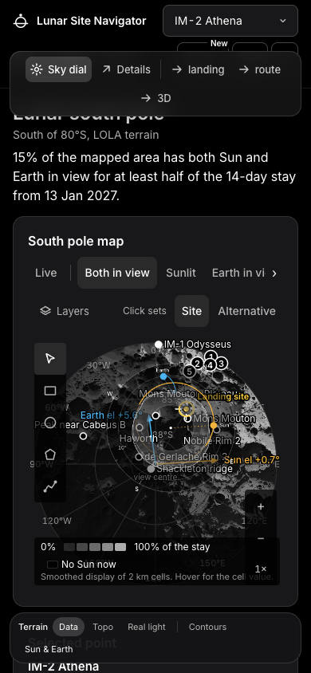

---

## 2. Map modes

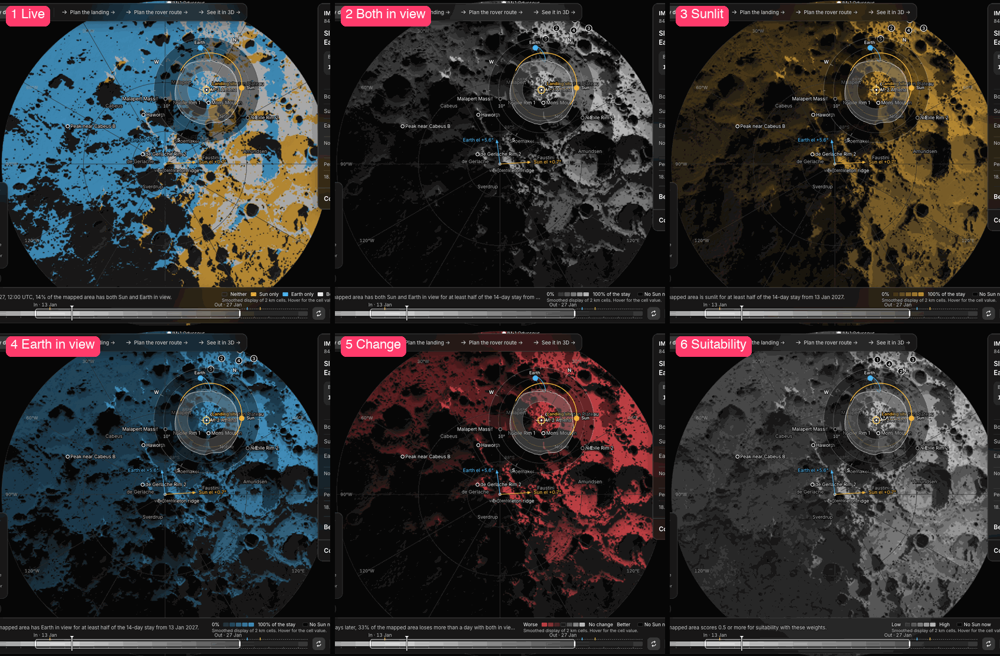

All modes except Live summarise the **whole mission window** (landing plus the stay); Live shows the playhead's
instant.

| Mode | Colour shows | Use it to |
|---|---|---|
| **1 Live** | Right now (at the playhead): neither, Sun only, Earth only, or both above the skyline | Watch the light and Earth move as the time bar plays |
| **2 Both in view** | Share of the stay with Sun *and* Earth above the skyline (dark 0 % → bright 100 %) | Find ground with power and a direct radio link at once |
| **3 Sunlit** | Share of the stay with the Sun above the skyline | Power and warmth |
| **4 Earth in view** | Share of the stay with Earth above the skyline | Direct-to-Earth radio |
| **5 Change** | Hours gained or lost with both in view if the landing slips by the slip set on the time bar (red worse, light better) | See which ground is fragile to a delay |
| **6 Suitability** | A weighted score 0–1 (Sun 40, Earth 30, gentle slope 20, near persistent shadow 10) | Rank ground on several needs at once |

The sentence in the time bar sums the map up, for example "15 % of the mapped area has both Sun and Earth in view
for at least half of the 14-day stay from 13 Jan 2027". Cells are 2 km (1 km when zoomed in), smoothed for display;
hover for the exact cell value.

**Sources and assumptions.** Sun and Earth directions: JPL Horizons, 3-hour steps, 1 Nov 2026 to 1 Jan 2029. Skyline:
LOLA terrain on 2 km and 1 km grids ([VARIABLES.md](../VARIABLES.md) §2 and §4). Suitability weights are ours
(VARIABLES §6), change them in Layers. **Limits:** skyline grids miss small nearby relief; "in view" means the
centre of the disc is above the skyline (no disc size, no Earthshine).

---

## 3. Layers

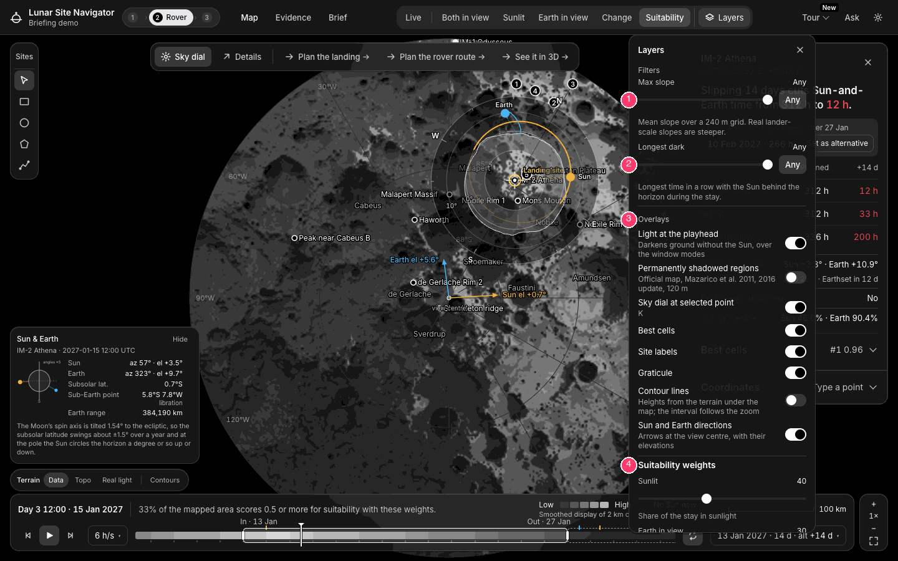

1. **Max slope** filter: greys out ground steeper than the value (mean slope over a 240 m grid; real lander-scale
   slopes are steeper).
2. **Longest dark** filter: greys out ground where the Sun stays behind the horizon longer than this, in one go,
   during the stay (useful against a battery's hours).
3. **Overlays:** *Light at the playhead* darkens ground without the Sun now; *Permanently shadowed regions* (official
   map, Mazarico et al. 2011, 2016 update, 120 m); *Sky dial at selected point* (key K); *Best cells*; *Site labels*;
   *Graticule*; *Contour lines*; *Sun and Earth directions* (arrows at the view centre with their elevations).
4. **Suitability weights** (Suitability mode only): Sunlit 40, Earth in view 30, Gentle slope 20 (full marks at 0°,
   none at 20° or more), Near persistent shadow 10 (full marks right next to it, none inside it or 50 km away).
   *Reset weights* puts them back.

---

## 4. Terrain styles, contours and the Sun & Earth readout

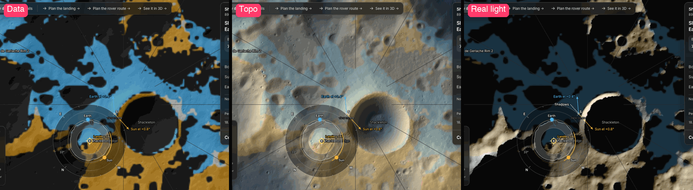

The **Terrain** chip (bottom left) changes how the ground is shaded under the colours:

* **Data** — the plain LOLA shading the figures are computed on.
* **Topo** — hillshade from several directions times a height tint, with the heat colours at 35 %; best for reading
  relief.
* **Real light** — the ground lit by the Sun at the playhead, pixel by pixel, with shadows cast across the terrain up
  to about 40 km away and the Moon's curvature included. This is what a camera would roughly see. (Display exposure
  is floored at a 15° Sun so the picture is readable; Earthshine is not modelled. VARIABLES §5.)
* **Contours** — contour lines from the terrain under the map; the interval follows the zoom (for example every
  200 m with labels every 1,000 m), index lines labelled.

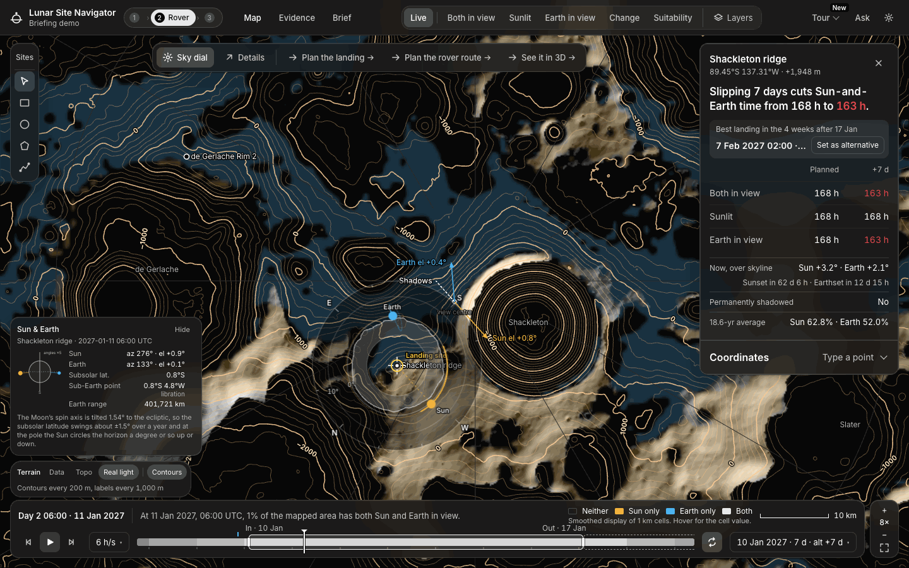

The **Sun & Earth** readout (left) gives, for the selected site at the playhead:

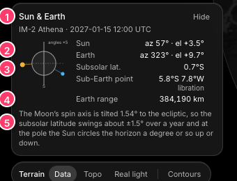

1. the site and the time (UTC);
2. Sun and Earth azimuth and elevation;
3. a small dial (angles drawn five times larger so you can see them);
4. the subsolar latitude, the sub-Earth point (moved by libration) and the Earth's distance;
5. why the Sun only circles the horizon here (the Moon's axis is tilted 1.54°).

*Hide* closes it; it comes back from Layers or the Settings.

---

## 5. The site card

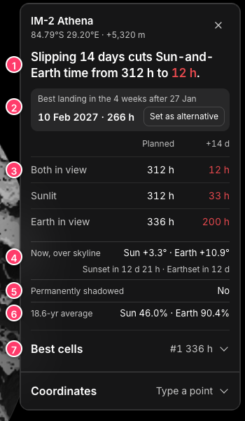

1. **Verdict** — one sentence on the most important change, here "Slipping 14 days cuts Sun-and-Earth time from
   312 h to 12 h".
2. **Best landing nearby in time** — the best landing date in the four weeks after the stay, with *Set as
   alternative* to compare it.
3. **Planned vs +14 d** — hours with both in view, sunlit and Earth in view, for the planned landing and the slipped
   one (red when worse).
4. **Now, over skyline** — Sun and Earth elevation above the skyline at the playhead, and time to the next sunset and
   Earthset.
5. **Permanently shadowed** — whether the point is inside a PSR.
6. **18.6-year average** — NASA's long-term Sun and Earth visibility at the point.
7. **Best cells** — the five best cells for the current mode, at least 20 km apart; click one to select it.

Below it, **Coordinates** lets you type any latitude and longitude ("Type a point"); then press **Pick this point** in the
action bar. The same panel takes typed corners or vertices for a region (**Apply to region A/B**, **Add vertex** in the
bar).

## 6. The sky dial and the Details sheet

With a site selected, **Sky dial** in the action bar (or key K) draws a dial around it on the map: rings are
elevation above the horizon, the white outline is the terrain skyline, the orange and blue tracks are the Sun's and
Earth's paths over the stay, the dots where they are at the playhead.

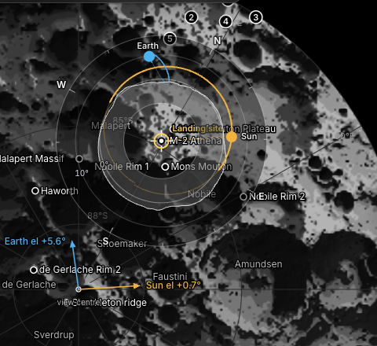

**Details** opens a sheet with four tabs:

| Overview | Power | Comms | Compare |
|---|---|---|---|
| 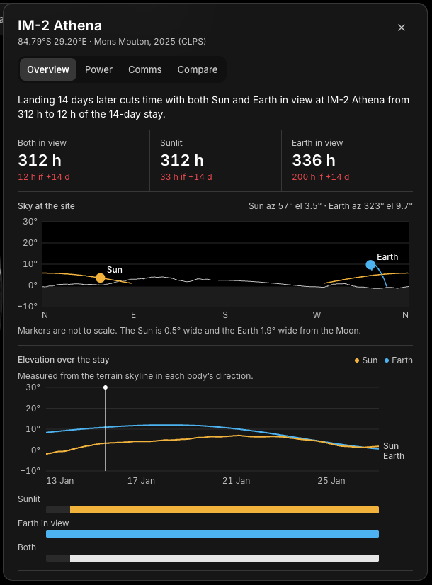 | 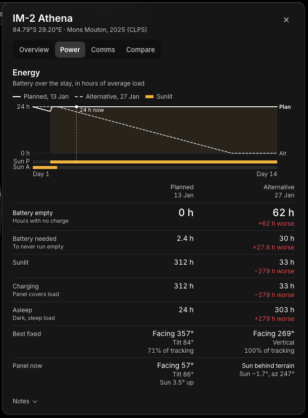 | 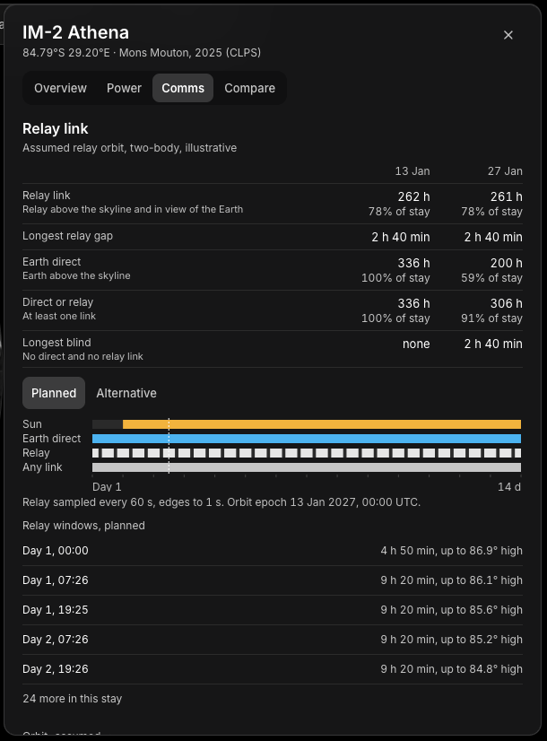 | 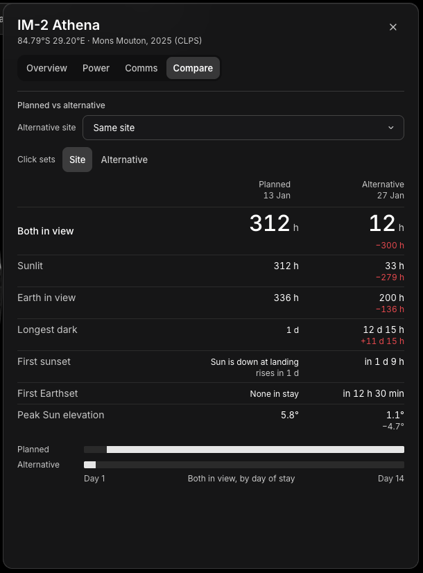 |

* **Overview** — the three totals with the slipped values; *Sky at the site*: a panorama of the skyline with the Sun
  and Earth (markers not to scale: the Sun is 0.5° and the Earth 1.9° wide from the Moon); *Elevation over the stay*:
  both bodies' height above the skyline, day by day; strips for sunlit, Earth in view and both; then every rise and
  set during the stay in a table.
* **Power** — battery over the stay in hours of average load for the planned and the alternative landing: hours with
  the battery empty, battery needed never to run empty, sunlit and charging hours, the best fixed panel direction and
  where the panel points now. (The load and panel ratio are assumptions, VARIABLES §3.)
* **Comms** — a relay link (an example orbit, two-body, illustrative): relay hours, longest relay gap, Earth direct
  hours, direct or relay, longest blind spell, a strip chart, and the relay windows.
* **Compare** — planned vs alternative side by side (alternative site or slipped date), with the longest dark spell,
  first sunset and Earthset and peak Sun elevation, and a bar of both-in-view hours per day.

## 7. Time bar and landing slip

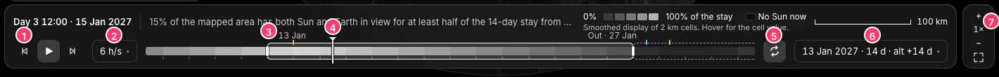

1. previous rise or set, play / pause, next rise or set;
2. speed (6 h of mission time per second by default);
3. the mission window, from **In** (landing) to **Out** (end of the stay), drag the ends to change it;
4. the **playhead** (drag it, or use the arrow keys);
5. loop between In and Out;
6. the mission summary: landing date, stay and slip (*13 Jan 2027 · 14 d · alt +14 d*); click it to change them;
7. zoom and full screen.

The strip behind the window shades each landing day by its hours with both in view, so you can see good and bad
landing days at a glance. Clicking the summary opens the landing settings:

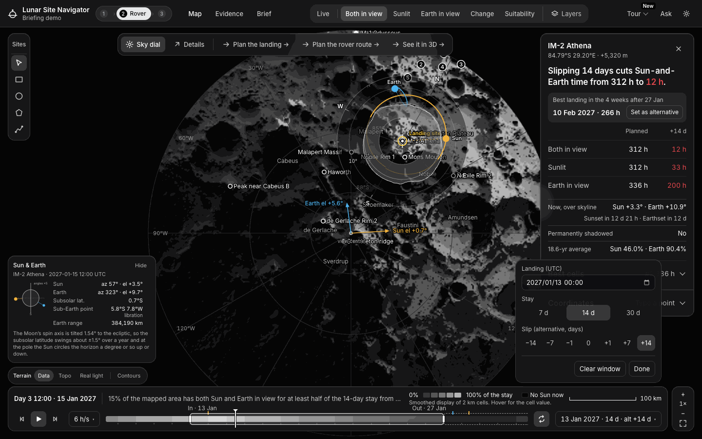

*Landing (UTC)*, *Stay* (7, 14 or 30 days), *Slip (alternative, days)* from −14 to +14, *Clear window* (no window: the
map switches to Live) and *Done*.

## 8. Regions and comparing two areas

Draw an area with **Rectangle**, **Circle** or **Polygon** (left toolbar), press **Apply to region A** in the action bar at the top of the map, then choose
**B** in the toolbar and draw a second one. The Regions panel shows each region's area, cells, sunlit, Earth and
both-in-view share, share that passes the filters, mean suitability and the best cell, side by side; *Pick the best
cell* (in the bar) selects it.

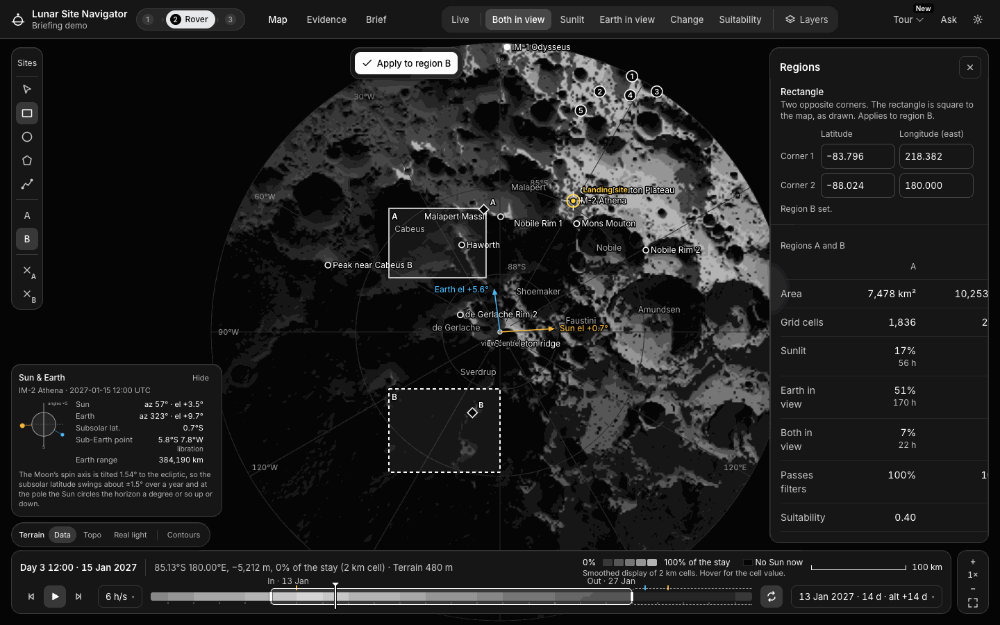

## 9. The site list

**Sites** (top left) lists the landing sites with the share of the stay they are sunlit: flown missions (Apollo 11
and 17, Blue Ghost M1, Chandrayaan-3, Chang'e-4, IM-1 Odysseus, IM-2 Athena), the Shackleton ridge, and the Artemis
III candidate regions as published by NASA in October 2024 (eight of the nine; marked "approx." in the data where the
coordinates are ours). *Custom site…* takes any coordinates. See [NASA-MISSION-PLANNING.md §3](../NASA-MISSION-PLANNING.md#3-choosing-where-to-land).

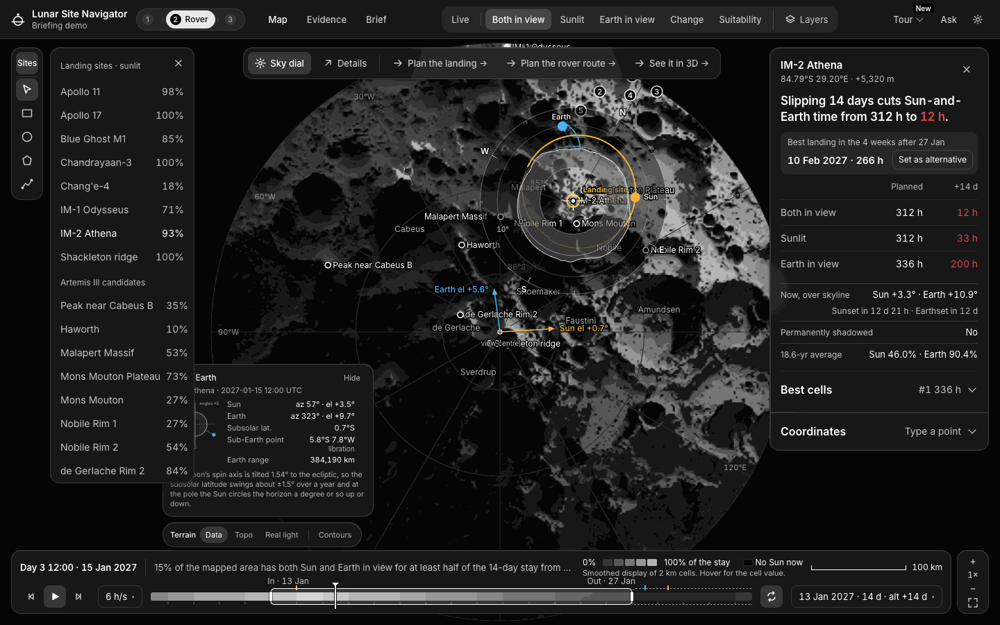

## 10. Going on: landing, rover, 3D

The action bar's **Plan the landing →** opens the lander page at this site and date, **Plan the rover route →**
opens the route card with the site as the start, **See it in 3D →** opens the globe.

## 11. Evidence, Brief, Tour, Ask, Settings

| | |
|---|---|
| 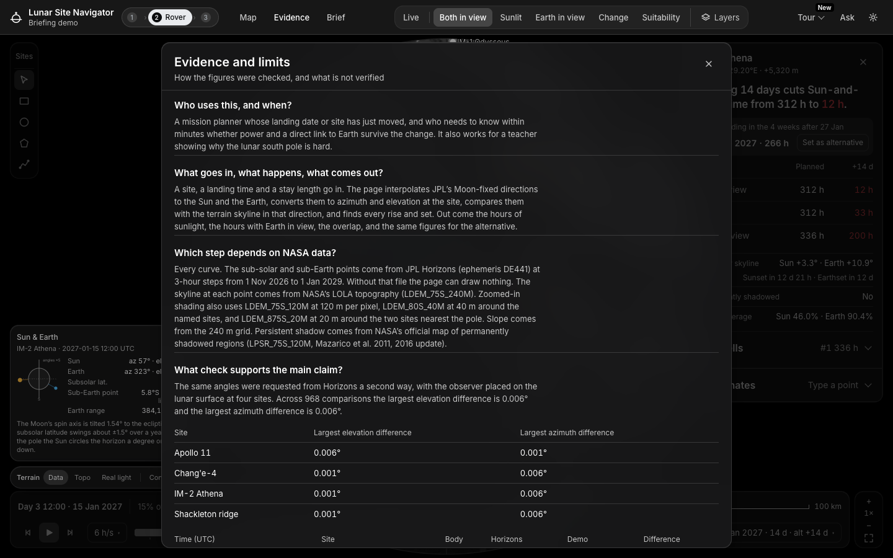 | **Evidence** — who the tool is for, what goes in and out, which step depends on NASA data, and the check behind the main claim: the angles were requested from Horizons a second time with the observer on the surface at four sites; across 968 comparisons the largest difference was 0.006°. |
| 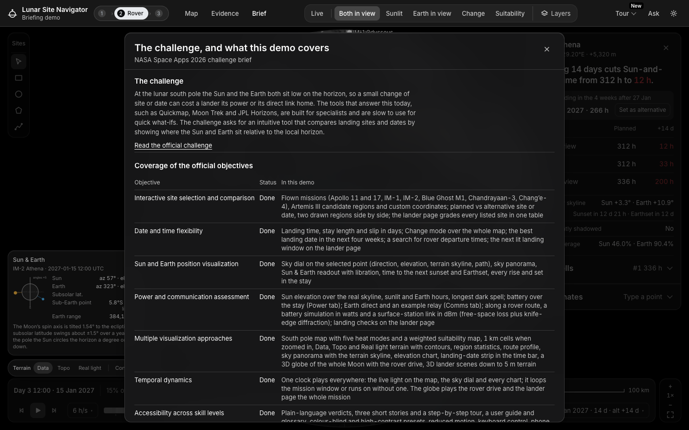 | **Brief** — the Space Apps challenge, a table of the seven official objectives with what the tool does for each, what is still left, and open questions for the team. The full check is in [challenge-coverage.md](challenge-coverage.md). |
| 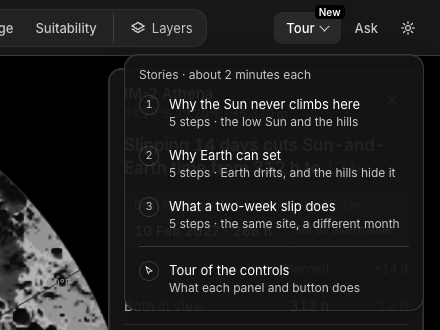 | **Tour** — three two-minute stories (*Why the Sun never climbs here*, *Why Earth can set*, *What a two-week slip does*) and a *Tour of the controls*. |
| 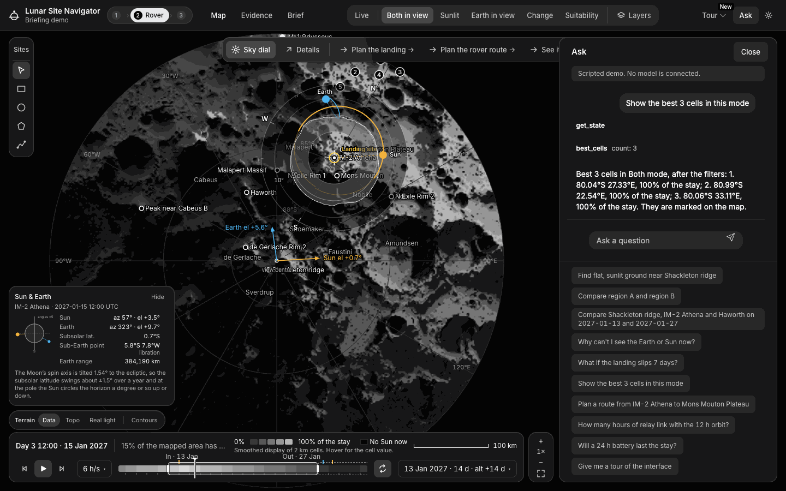 | **Ask** — questions in plain words. By default it is a **scripted offline demo**: the answers come from the page's own commands (here "Show the best 3 cells in this mode"). With your own key it can use an Anthropic or OpenAI-compatible model (Settings). |
| 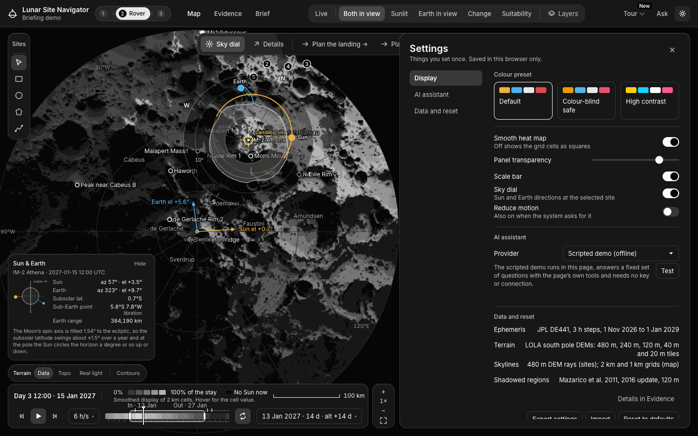 | **Settings** — colour preset (default, colour-blind safe, high contrast), smooth heat map, panel transparency, scale bar, sky dial, reduce motion; the AI provider; data sources; export, import and reset. Saved in this browser only. |

---

## Use case A: Is IM-2's landing date robust to a two-week slip?

*Question: we plan to land at the IM-2 Athena site (84.79°S, 29.20°E, Mons Mouton) on 13 Jan 2027 for 14 days. How
much do we lose if the landing slips two weeks?*

1. Open the navigator. Pick **IM-2 Athena** in *Sites* (it is the default) and keep the mission summary on the time
   bar at *13 Jan 2027 · 14 d · alt +14 d*.
2. Choose the **Both in view** mode. The site sits on bright ground: most of the stay has power and a direct link.
3. Read the **site card**: *Both in view 312 h* planned against **12 h** if the landing is 14 days later; sunlit
   312 h → 33 h; Earth in view 336 h → 200 h.
4. Switch to **Change**: the red ground (33 % of the map) loses more than a day with both in view after a 14-day slip.
   The site is in the red.
5. Open **Details → Power**: with the planned landing the battery is never empty (2.4 h of battery is enough); after
   the slip it is empty for 62 h and would need 30 h of storage.
6. Open **Details → Comms**: Earth direct is 100 % of the stay planned, 59 % after the slip, with a 2 h 40 min blind
   spell even with the example relay.
7. **Decide.** The site works for the planned date only. The card's *Best landing in the 4 weeks after 27 Jan* gives
   a backup: **10 Feb 2027 · 266 h**; press *Set as alternative* and compare in *Details → Compare*. Keep a second site
   or the 10 Feb date as the contingency.

## Use case B: Find the best ground for a long stay

1. Choose **Suitability**. Open **Layers** and set *Max slope* to about 10° and *Longest dark* to the hours your
   battery covers (for example 24 h). Greyed ground fails.
2. Change the weights if your mission is different (more weight on *Earth in view* for a radio-heavy mission).
3. Open **Best cells** in the site card: five cells at least 20 km apart, with their scores. Click one to select it.
4. Check it in **Details** (rises and sets, power) and with a second date (*Set as alternative*).

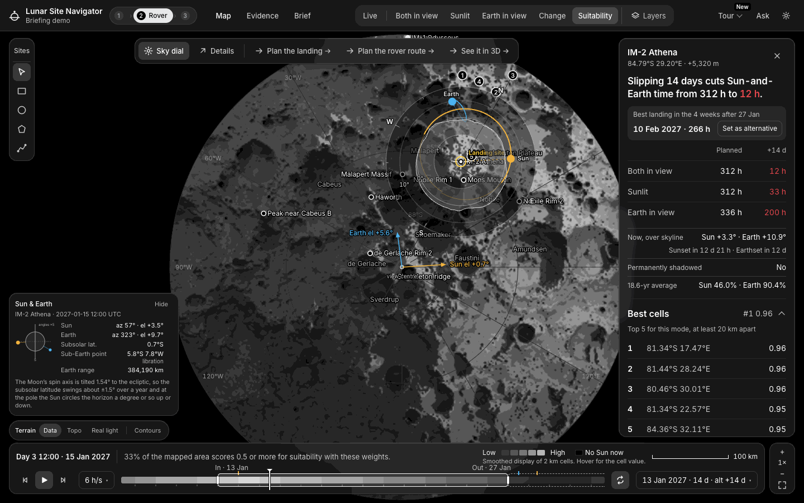

## Use case C: Compare two candidate areas

1. Draw a rectangle around the first area and press **Apply to region A** in the action bar.
2. Choose **B** in the left toolbar, draw the second area, press **Apply to region B**.
3. Compare *Sunlit*, *Earth in view*, *Both in view*, *Passes filters* and *Suitability* side by side (screenshot in
   [§8](#8-regions-and-comparing-two-areas)). *Pick the best cell* in the better region and continue with use case A.
